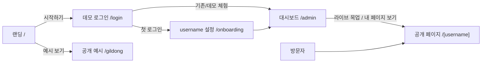
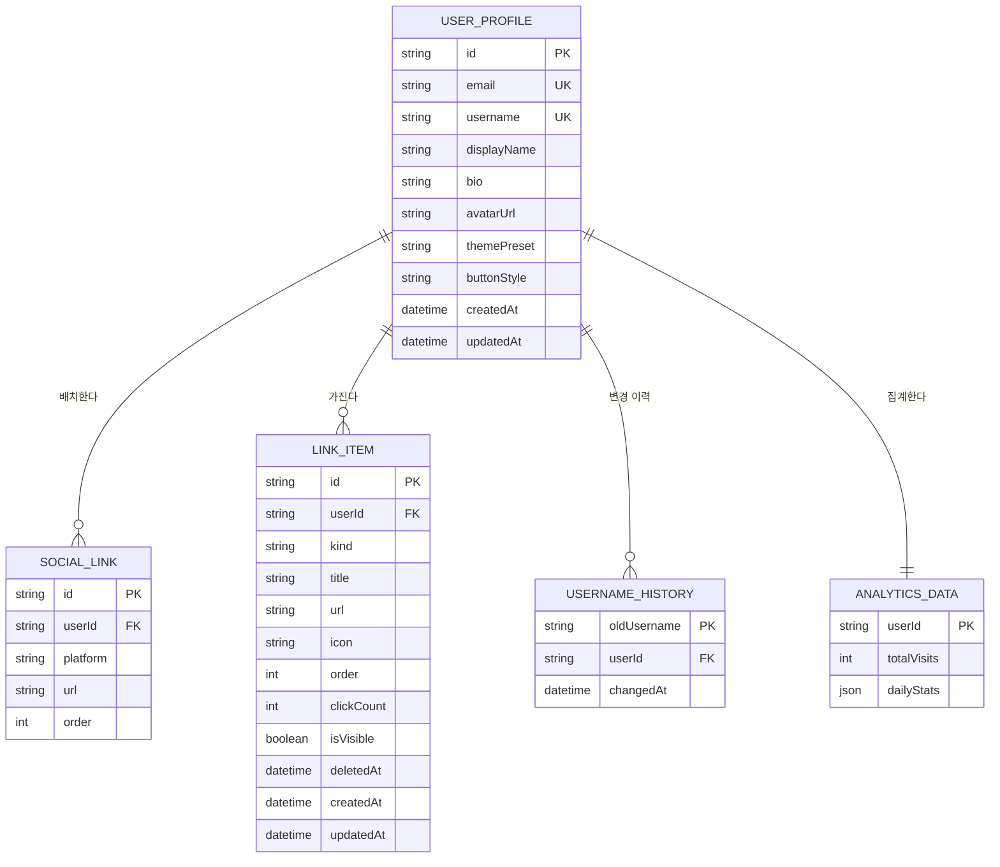

# 마이링크 (MyLink) — 기능정의서 (PRD)

> 링크트리(Linktree) 클론 서비스 — 멀티 링크 & 바이오 프로필 서비스
> 문서 버전: v3.2 · 작성일: 2026-11-14 · 상태: 확정(Confirmed)
> v3.2 변경: `10. 구현 로드맵 및 시연 마일스톤` 추가 (폴더·모듈 구조, M1~M3 마일스톤, 네이티브 드래그·경량 SVG 차트 직접 구현, End-to-End 시연 시나리오)
> v3.1 변경: 전역 상태 관리를 Zustand(`persist` 미들웨어 + `localStorage` Storage Adapter)로 확정
> v3.0 변경: 클라이언트 완결형 데모(Next.js App Router + `localStorage` + Mock 데이터) 전환, 공개 프로필 확장(아바타·소셜 미디어 배치·섹션 구분 헤더), 대시보드 UX 확장(드래그 앤 드롭·테마 설정·통계 및 추이 차트) 반영

---

## 1. 프로젝트 개요

| 항목 | 내용 |
|---|---|
| **이름** | 마이링크 (MyLink) |
| **목적** | 개인 크리에이터 및 일반 사용자가 여러 개의 링크(SNS, 블로그, 포트폴리오, 쇼핑몰 등)와 프로필을 한 페이지에 모아 공유하는 **멀티 링크 & 바이오 프로필 서비스** |
| **대상** | 개인 크리에이터, SNS 사용자, 일반 사용자, 인플루언서, 프리랜서, 소상공인 |
| **핵심** | 링크·소셜·섹션 CRUD (Create · Read · Update · Delete) + 개인 URL(`/[username]`) 공유 + 실시간 라이브 프리뷰 대시보드 + 기본 통계 |
| **해결하는 문제** | 인스타그램·틱톡 등 SNS 프로필에 링크를 1개만 넣을 수 있는 제약 해소 |
| **구현 형태** | **Next.js (App Router) 기반 클라이언트 완결형 데모** — 별도 백엔드 서버·DB 구축 없이 브라우저 `localStorage` 및 Mock 데이터 연동으로 즉시 동작 |
| **기술 스택** | Next.js 16 (App Router) · React 19 · TypeScript · Tailwind CSS 4 · **Zustand 5** (`persist` 미들웨어) · Web Storage(`localStorage`) · Mock 데이터 |
| **디자인 기준** | [`design.md`](./design.md) (단일 액센트 블루 `#0066cc` / 다크 타일 위 `#2997ff`, 필 버튼, 상단 라이트/하단 다크 풀블리드 타일 교차 기본 테마) |

### 1.1 성공 지표 (KPI)

| 지표 | 목표 |
|---|---|
| 대시보드 진입 후 첫 링크 추가까지 걸리는 시간 | 1분 이내 |
| 공개 페이지 초기 화면 렌더링 (LCP) | 2.5초 이내 |
| 링크 추가 성공률 (유효성 안내 포함 오류 없이 저장) | 95% 이상 |

---

## 2. 기능 목록

**우선순위 기준**
- **필수 (P0)**: 데모 MVP 출시에 반드시 포함되는 핵심 기능
- **선택 (P1)**: 사용성을 높이는 부가 기능
- **선택 (P2)**: 향후 실제 서버 연동 시 확장할 기능

| ID | 구분 | 기능명 | 설명 | 우선순위 |
|---|---|---|---|---|
| F-01 | 링크 | 링크 목록 표시 | 등록한 링크·섹션 구분 헤더를 순서대로 카드 형태로 표시 | **필수 (P0)** |
| F-02 | 링크 | 링크 추가 | 제목·URL·아이콘(도메인 자동 추천)을 인라인 폼으로 추가 | **필수 (P0)** |
| F-03 | 링크 | 링크 수정 | 해당 카드를 인라인 편집 상태로 전환해 제목·URL·아이콘 변경 | **필수 (P0)** |
| F-04 | 링크 | 링크 삭제 | 확인 대화상자 후 Soft Delete + 5초 실행 취소(Undo) 제공 | **필수 (P0)** |
| F-05 | 공유 | 개인 URL (`/[username]`) | 사용자별 고유 공개 페이지 + username 변경 시 이전 주소 영구 리다이렉트 | **필수 (P0)** |
| F-06 | 계정 | 데모 인증 (Mock 이메일 로그인) | 서버 없이 `localStorage` 기반으로 동작하는 Mock 이메일 6자리 코드 로그인 + 원클릭 데모 체험 + `/onboarding` | **필수 (P0)** |
| F-07 | 프로필 | 프로필 영역 (아바타·이름·자기소개) | 공개 페이지 상단 프로필 표시(아바타 이미지 선택/업로드·이름·소개) 및 편집 | **필수 (P0)** |
| F-08 | 프로필 | 소셜 미디어 배치 | 프로필 영역 하단에 SNS 아이콘 버튼 가로 배치 및 추가·수정·삭제 | **필수 (P0)** |
| F-09 | 링크 | 섹션 구분 헤더 | 링크 목록을 주제별로 나누는 섹션 제목/헤어라인 구분선 추가·수정·삭제 | **필수 (P0)** |
| F-10 | 링크 | 링크·섹션 순서 변경 | **드래그 앤 드롭**으로 순서 변경 (+ 접근성·모바일용 `▲`/`▼` 버튼 보조 지원) | **필수 (P0)** |
| F-11 | 대시보드 | 실시간 라이브 프리뷰 | 편집 중인 프로필·링크·소셜·테마 변경 사항을 **모바일 목업**에 실시간 반영 | **필수 (P0)** |
| F-12 | 대시보드 | 테마 설정 | 프리셋 테마(Apple 기본 교차/라이트/다크 등) 및 버튼 스타일 변경 | **필수 (P0)** |
| F-13 | 통계 | 통계 및 분석 | **총 방문자 수, 링크별 클릭 누적 수, 최근 추이 차트** 제공 (Mock 시드 + 실시간 누적) | **필수 (P0)** |
| F-14 | 링크 | 링크 공개/숨김 토글 | 삭제하지 않고 공개 페이지에서만 숨김 | 선택 (P1) |
| F-15 | 공유 | URL 복사 / QR 코드 | 내 페이지 주소 원클릭 복사, QR 코드 이미지 생성 | 선택 (P1) |
| F-16 | 데이터 | 데이터 초기화 / 내보내기 | 데모 데이터를 초기 Mock 상태로 리셋하거나 JSON으로 내보내기 | 선택 (P1) |
| F-17 | 확장 | 실서버·DB·메일 API 연동 | 향후 Supabase/PostgreSQL 및 Resend 실제 이메일 인증 전환 | 선택 (P2) |

---

## 3. 화면 구성 및 라우팅

| 경로 | 화면 | 접근 권한 | 설명 |
|---|---|---|---|
| `/` | 랜딩 페이지 | 누구나 | 마이링크 서비스 소개, `시작하기` 버튼, `예시 보기(/gildong)` 링크 |
| `/login` | 데모 이메일 로그인 | 비로그인 | ① 이메일 입력 → ② 화면 내 안내되는 Mock 6자리 코드 입력 (또는 `데모 계정으로 바로 체험하기` 버튼) |
| `/onboarding` | username 설정 | 첫 로그인 사용자 | `username`만 입력받아 초기 설정 완료 (`이름`은 `username`으로 자동 초기화) |
| `/admin` | 대시보드 (편집기) | 로그인/데모 사용자 | **PC**: 좌측 `[프로필·링크 | 테마 | 통계]` 편집 영역 · 우측 **실시간 모바일 목업 프리뷰** 2단 분할 / **모바일**: 상단 `[편집 | 미리보기]` 탭 전환 |
| `/[username]` | 공개 프로필 페이지 | 누구나 | 프로필(아바타·이름·소개) + 소셜 미디어 아이콘 배치 + 섹션 구분 헤더 + 기본 URL 링크 버튼 (읽기 전용). 기존 홍길동 프로필을 `/gildong` 기본 Mock 데이터로 제공 |



---

## 4. 상세 기능 정의

### F-01. 링크·섹션 목록 표시 — 필수 (P0)

| 항목 | 내용 |
|---|---|
| **설명** | 사용자가 등록한 기본 URL 링크 버튼과 섹션 구분 헤더를 지정된 순서대로 세로 목록으로 표시 |
| **동작 방식** | 페이지 진입 → `localStorage`(초기 접속 시 Mock 시드 자동 적재)에서 삭제되지 않은(`deletedAt === null`) 항목 조회 → `order` 오름차순 정렬 → 섹션 구분 헤더와 링크 버튼 렌더링 |
| **입력** | `username` (공개 페이지) 또는 현재 세션 사용자 ID (대시보드) |
| **출력** | • **공개 페이지**: 섹션 구분 헤더(제목 + 얇은 헤어라인) + 기본 URL 링크 버튼(아이콘 + 제목). 클릭 시 클릭 통계 누적 후 새 탭(`_blank`) 이동 (`mailto:`는 기본 메일 앱 실행)<br>• **대시보드**: 드래그 핸들(`⋮⋮`), 순서 보조 버튼(`▲`/`▼`), `수정`, `삭제` 버튼이 포함된 카드 목록 |
| **예외 처리** | • 항목 0개: 대시보드 → `"첫 링크를 추가해 보세요"` 안내 + 추가 버튼 강조 / 공개 페이지 → `"아직 등록된 링크가 없습니다"` 표시<br>• `localStorage` 데이터 손상 시: 손상 감지 후 기본 Mock 데이터(`/gildong`)로 안전 초기화 및 알림 토스트 표시 |

### F-02. 링크 추가 — 필수 (P0)

| 항목 | 내용 |
|---|---|
| **설명** | 제목, URL, 아이콘을 입력받아 목록에 새 기본 URL 링크 추가 |
| **동작 방식** | `+ 링크 추가` 버튼 클릭 → **목록 상단에 인라인 입력 카드 펼침** → URL 입력 시 도메인에 맞춰 아이콘 자동 추천 → 값 입력 후 `저장` 클릭 → 유효성 검사 → `localStorage` 저장 → 목록 맨 아래에 새 카드 추가 및 입력 폼 닫힘 → 라이브 프리뷰 즉시 반영 + `"링크가 추가되었습니다"` 토스트 |
| **취소** | `취소` 버튼 또는 `Esc` 키 → 입력값 버리고 인라인 폼 접힘 |

**입력 항목**

| 필드 | 타입 | 필수 | 규칙 | 예시 |
|---|---|---|---|---|
| 제목 | 텍스트 | ✅ | 1~50자, 앞뒤 공백 제거 | `내 인스타그램` |
| URL | 텍스트 | ✅ | `http://`, `https://`, `mailto:` 스킴만 허용, 최대 2,048자 | `https://instagram.com/myid`, `mailto:hello@example.com` |
| 아이콘 | 선택 목록 | ❌ | 12종 중 선택 (기본값: `link`). URL 입력 시 도메인·스킴 기반 자동 선택(수동 변경 가능) | `link`, `instagram`, `youtube`, `tiktok`, `x`, `threads`, `github`, `kakao`, `naver`, `blog`, `email`, `shop` |

**아이콘 자동 추천 규칙**
- `instagram.com` → `instagram` / `youtube.com`, `youtu.be` → `youtube` / `tiktok.com` → `tiktok`
- `x.com`, `twitter.com` → `x` / `threads.net` → `threads` / `github.com` → `github`
- `kakao.com`, `open.kakao.com`, `pf.kakao.com` → `kakao` / `naver.com`, `blog.naver.com`, `smartstore.naver.com` → `naver`
- `mailto:` → `email` / 기타 URL은 기본 `link` (사용자 직접 변경 가능)

**출력**: 목록 맨 아래에 새 링크 카드 추가 + 모바일 목업 라이브 프리뷰 즉시 갱신

**예외 처리**

| 상황 | 처리 |
|---|---|
| URL 형식 오류 | 입력창 테두리 **빨간색(`#e30000`)** + 아래 빨간 글씨 `"올바른 URL 형식이 아닙니다 (예: https://example.com 또는 mailto:name@example.com)"` |
| 프로토콜 누락 (`instagram.com/myid`) | 포커스 아웃(blur) 또는 저장 시 자동으로 `https://`를 앞에 붙여 보정 후 검사 |
| `mailto:` 형식 오류 (`mailto:abc`) | 올바른 이메일 형식이 아니면 빨간색 경고 `"올바른 이메일 주소 형식이 아닙니다"` |
| 제목 미입력 | 입력창 빨간색 + `"제목을 입력해 주세요"` |
| 제목 50자 초과 | 입력 제한 + 글자 수 카운터(`50/50`) 빨간색 |
| `javascript:`, `data:`, `vbscript:` 등 위험 스킴 | 저장 거부 + `"허용되지 않는 URL입니다"` |
| 링크·헤더 합산 최대치(50개) 초과 | 추가 버튼 비활성화 + `"항목은 최대 50개까지 등록할 수 있습니다"` |
| 저장 공간(`localStorage`) 초과 | 입력값 유지 + `"브라우저 저장 공간이 부족합니다"` 안내 |

> 유효성 검사 시점: 입력창에서 포커스가 빠질 때(blur) 1차 검사, `저장` 클릭 시 최종 검사. 오류가 있으면 저장되지 않음.

### F-03. 링크 수정 — 필수 (P0)

| 항목 | 내용 |
|---|---|
| **설명** | 등록된 링크의 제목·URL·아이콘 변경 |
| **동작 방식** | 링크 카드의 `수정` 버튼 클릭 → **해당 카드 자체가 기존 값이 채워진 인라인 편집 폼으로 전환** → 값 변경 → `저장` 클릭 → 유효성 검사 → `localStorage` 저장 → 일반 카드 상태로 복귀 및 라이브 프리뷰 즉시 반영 → `"수정되었습니다"` 토스트 |
| **입력** | F-02와 동일 (기존 값 미리 채움) |
| **출력** | 수정된 내용이 반영된 링크 카드 (순서 유지) |
| **예외 처리** | • 유효성 오류: F-02와 동일 (빨간색 경고)<br>• 변경 사항 없음: `저장` 버튼 비활성화<br>• 수정 중 취소(`취소` 또는 `Esc`): 변경 내용 버리고 원래 값으로 복귀<br>• 이미 삭제된 항목: `"존재하지 않는 링크입니다"` 안내 후 목록 새로고침 |

### F-04. 링크 삭제 — 필수 (P0)

| 항목 | 내용 |
|---|---|
| **설명** | 확인 대화상자와 5초 실행 취소(Undo)를 모두 제공하는 안전한 링크·섹션 삭제 |
| **동작 방식** | ① `삭제` 버튼 클릭 → 확인 대화상자 `"'{제목}' 항목을 삭제할까요?"` 표시<br>② `삭제` 클릭 → `localStorage`에서 **Soft Delete(`deletedAt` 기록)** 처리 → 목록·라이브 프리뷰에서 즉시 제거<br>③ 화면 하단에 `"삭제되었습니다 · 실행 취소"` 토스트를 **5초간** 표시<br>④ 5초 이내 `실행 취소` 클릭 → `deletedAt = null`로 복구 → 원래 순서(`order`)로 목록 복원 |
| **입력** | 삭제할 항목 ID |
| **출력** | 해당 항목이 제거(또는 실행 취소 시 복구)된 목록 |
| **예외 처리** | • 확인 대화상자에서 `취소`: 아무 변화 없음<br>• 5초 경과 후: 토스트 자동 닫힘 및 실제 정리(또는 보존 후 영구 제거) |

### F-05. 개인 URL (`/[username]`) — 필수 (P0)

| 항목 | 내용 |
|---|---|
| **설명** | 사용자마다 `/username` 형태의 고유 공개 프로필 페이지 제공 및 변경 시 이전 주소 자동 연결 |
| **동작 방식** | 방문자가 `/{username}` 접속 → ① `localStorage` 및 Mock 사용자 목록에서 활성 `username` 조회 → ② 없으면 `USERNAME_HISTORY`에서 `oldUsername` 조회 후 해당 사용자의 **현재 `/[username]`으로 자동 리다이렉트** → ③ 둘 다 없으면 404 표시 |
| **입력** | URL 경로의 `username` |
| **출력** | 읽기 전용 공개 프로필 페이지 (프로필 + 소셜 미디어 배치 + 섹션 구분 헤더 + 링크 목록 + 하단 `"MyLink로 나만의 페이지 만들기"` 배너) |

**username 규칙 및 변경 정책**

| 규칙 | 내용 |
|---|---|
| 길이 | 3~20자 |
| 허용 문자 | 영문 소문자, 숫자, 밑줄(`_`), 마침표(`.`) (연속된 마침표 `..` 및 시작/끝 마침표 `.` 제한 권장) |
| 중복 불가 | 현재 사용 중인 `username`은 물론, **다른 사용자의 이전 `username` 이력도 사용 불가** |
| 예약어 | `admin`, `login`, `onboarding`, `api`, `auth`, `settings`, `about`, `demo`, `404`, `robots.txt`, `sitemap.xml` 등 시스템 경로 사용 불가 |
| 변경 가능 여부 | `/admin` 프로필/계정 영역에서 **횟수 제한 없이 변경 가능** (변경 시 이전 `username`은 히스토리에 기록되어 영구 리다이렉트) |
| 과거 내 이름으로 복귀 | 본인이 예전에 쓰던 `username`으로 되돌리는 것은 허용 (순환 리다이렉트 방지를 위해 해당 히스토리 정리) |

**예외 처리**

| 상황 | 처리 |
|---|---|
| 존재하지 않는 username | 404 페이지 `"페이지를 찾을 수 없습니다"` + 홈(`/`) 및 예시(`/gildong`) 이동 버튼 |
| 설정·변경 시 중복 또는 타인의 이전 username | 입력창 빨간색 + `"이미 사용 중이거나 사용할 수 없는 이름입니다"` |
| 규칙 위반 또는 예약어 입력 | 입력창 빨간색 + 위반한 규칙 안내 |
| 대문자로 접속 (`/Gildong`) | 소문자 경로(`/gildong`)로 리다이렉트 |
| 이전 username으로 접속 (`/old_name`) | 현재 활성 username(`/new_name`)으로 자동 리다이렉트 |

### F-06. 데모 인증 (Mock 이메일 로그인) — 필수 (P0)

| 항목 | 내용 |
|---|---|
| **설명** | 별도 서버·메일 발송 API 없이 **브라우저 내부에서 완결되는 Mock 이메일 인증 로그인** 및 **원클릭 데모 계정 체험** 제공 |
| **동작 방식** | ① `/login`에서 이메일 입력 → `인증코드 받기` 클릭 (또는 `데모 계정(/gildong)으로 바로 시작하기` 클릭 시 즉시 `/admin` 이동)<br>② 클라이언트가 6자리 Mock 인증코드를 생성해 `localStorage`에 임시 저장하고, **화면 내 데모 배너/토스트에 발급된 6자리 코드를 표시** (예: `[데모 안내] 발송된 인증코드: 123456`)<br>③ 코드 입력 → `확인` 클릭 → 검증 성공 시 `localStorage` 세션 발급 → **기존 이메일**은 `/admin`, **첫 로그인 이메일**은 `/onboarding` 이동<br>④ `/onboarding`에서 `username` 입력 시 **`displayName` 기본값을 `username`으로 자동 초기화** → `/admin` 이동<br>로그아웃: `localStorage` 세션 삭제 → `/` 이동 |
| **입력** | 이메일 / 인증코드(숫자 6자리) / username (첫 로그인 시 `/onboarding`) |
| **출력** | 화면 내 모의 인증코드 안내 배너, 브라우저 세션 상태(`mylink_session`) |
| **규칙** | 6자리 숫자, 유효시간 10분(타이머 표시), 1회용, 5회 오입력 시 무효화 후 재발급 |
| **예외 처리** | • 이메일 형식 오류: 입력창 빨간색 + `"올바른 이메일 형식이 아닙니다"`<br>• 인증코드 불일치: 입력창 빨간색 + `"인증코드가 올바르지 않습니다 (남은 시도 4회)"`<br>• 코드 만료 / 5회 오입력: 코드 무효화 + 재발급 안내<br>• 비로그인 상태로 `/admin`, `/onboarding` 접근: `/login`으로 리다이렉트 (단, `데모 바로 체험` 버튼 제공) |

### F-07. 프로필 영역 (아바타·이름·자기소개) — 필수 (P0)

| 항목 | 내용 |
|---|---|
| **설명** | 공개 페이지 최상단에 표시되는 크리에이터/사용자 프로필 정보 |
| **동작 방식** | `/admin` 프로필 섹션에서 아바타 이미지 선택(또는 프리셋 선택), 이름, 자기소개를 수정하고 `저장` → `localStorage` 저장 → 라이브 프리뷰 및 `/[username]` 즉시 반영 |
| **입력** | • **아바타**: 이미지 파일 업로드(JPG/PNG/WebP → 클라이언트에서 최대 256×256px 리사이징 후 Data URL 저장) 또는 기본/프리셋 아바타 선택<br>• **이름**: 1~30자 필수 (온보딩 직후 기본값 `username`)<br>• **자기소개**: 0~150자 선택 (줄바꿈 허용) |
| **출력** | 공개 페이지 상단 프로필 타일: 원형 아바타 → 이름 → `@username` → 자기소개 순서로 가운데 정렬 표시 |
| **예외 처리** | • 이름 미입력: 빨간색 경고 `"이름을 입력해 주세요"`<br>• 이름 30자 / 소개 150자 초과: 입력 제한 + 글자 수 카운터 빨간색<br>• 지원하지 않는 이미지 형식 또는 2MB 초과 파일: 빨간색 경고 `"JPG, PNG, WebP 형식(2MB 이하)만 등록할 수 있습니다"`<br>• 아바타 미등록 시: 이름 첫 글자 기반 기본 아바타 표시 |

### F-08. 소셜 미디어 배치 — 필수 (P0)

| 항목 | 내용 |
|---|---|
| **설명** | 공개 프로필 상단 자기소개 아래에 주요 SNS 채널을 콤팩트한 아이콘 버튼 행으로 가로 배치 |
| **동작 방식** | `/admin`의 소셜 미디어 관리 영역에서 `+ 소셜 추가` 클릭 → 플랫폼 선택 + URL(또는 이메일) 입력 → 저장 → 라이브 프리뷰 및 공개 페이지 프로필 하단에 원형/필 아이콘 버튼으로 나열 (최대 8개, 순서 조정·삭제 가능) |
| **입력** | 플랫폼 (`instagram`, `youtube`, `tiktok`, `x`, `threads`, `github`, `kakao`, `naver`, `email`), URL (`http://`, `https://`, `mailto:`) |
| **출력** | 프로필 영역 내 가로 정렬 소셜 아이콘 바 (`aria-label` 포함, 클릭 시 새 탭 이동) |
| **예외 처리** | • URL 형식 오류: F-02와 동일하게 빨간색 경고 + 저장 차단<br>• 같은 플랫폼 중복 추가 시: 안내 경고 또는 허용 여부 체크(플랫폼당 1개 권장)<br>• 최대 8개 초과 시: 추가 버튼 비활성화 + `"소셜 링크는 최대 8개까지 배치할 수 있습니다"`<br>• 등록된 소셜 0개: 공개 페이지에서 소셜 아이콘 행 숨김(빈 여백 제거) |

### F-09. 섹션 구분 헤더 — 필수 (P0)

| 항목 | 내용 |
|---|---|
| **설명** | 링크 버튼이 많아졌을 때 주제별로 그룹을 나누어 보여주는 구분 제목 및 얇은 헤어라인(구분선) 블록 |
| **동작 방식** | `/admin`에서 `+ 섹션 헤더 추가` 버튼 클릭 → 섹션 제목 입력(예: `인기 콘텐츠`, `문의 및 스토어`) → 저장 → 링크 목록에 헤더 카드가 추가되며, 드래그 앤 드롭으로 원하는 링크들 사이에 자유롭게 배치 |
| **입력** | 섹션 제목 (1~30자, 필수), 구분선 표시 여부(기본 `true`) |
| **출력** | 공개 페이지 링크 목록 내 구분선 + 소제목 헤더로 렌더링 (클릭 동작 없는 비인터랙티브 구획 요소) |
| **예외 처리** | • 제목 미입력: 입력창 빨간색 + `"섹션 제목을 입력해 주세요"`<br>• 30자 초과: 입력 제한 + 카운터 빨간색<br>• 수정/삭제/실행 취소: F-03, F-04와 동일하게 인라인 편집 및 5초 Undo 지원 |

### F-10. 링크·섹션 순서 변경 (드래그 앤 드롭) — 필수 (P0)

| 항목 | 내용 |
|---|---|
| **설명** | 대시보드 편집기에서 링크 버튼과 섹션 구분 헤더의 순서를 직관적으로 재배치 |
| **동작 방식** | 각 카드 좌측 핸들(`⋮⋮`)을 **드래그 앤 드롭**하여 원하는 위치에 놓음 (모바일·키보드 접근성을 위해 `▲`/`▼` 이동 버튼도 함께 제공) → 전체 항목 `order` 재계산 → `localStorage` 즉시 저장 → 우측 모바일 목업 라이브 프리뷰 즉시 반영 |
| **입력** | 드래그한 항목 ID, 대상 위치 인덱스(또는 `▲`/`▼` 방향) |
| **출력** | 변경된 순서대로 정렬된 목록 및 프리뷰 |
| **예외 처리** | • 항목이 0~1개일 때: 드래그/이동 비활성화<br>• 드래그 중 영역 밖으로 취소(Esc 등): 원래 순서 유지<br>• 첫 항목의 `▲`, 마지막 항목의 `▼` 비활성화 |

### F-11. 대시보드 실시간 라이브 프리뷰 — 필수 (P0)

| 항목 | 내용 |
|---|---|
| **설명** | 편집 중인 공개 프로필 화면을 스마트폰 목업 프레임으로 실시간 미리보기 |
| **동작 방식** | 대시보드 상태(프로필, 소셜, 링크, 섹션 헤더, 테마) 변경 즉시 별도 저장 버튼 없이도(또는 저장 시 즉시) 우측 모바일 목업에 동일 컴포넌트로 렌더링 |
| **입력** | 현재 편집기 상태 (`UserProfile`, `SocialLink[]`, `LinkItem[]`, `ThemePreset`) |
| **출력** | 모바일 비율(예: 375px 폭) 프레임 내 실제 공개 페이지와 동일한 미리보기 + 상단 `내 페이지 열기(/username)` 버튼 |
| **예외 처리** | • 좁은 화면(태블릿/모바일 ≤ 1023px): 2단 분할 대신 상단 `[편집 | 미리보기]` 탭 전환으로 화면 겹침 방지<br>• 미리보기 내부 링크 클릭 시 실제 외부 이동 대신 `"미리보기 모드입니다"` 안내 또는 새 탭 열기 선택 (단, **통계 클릭 수에는 합산하지 않음**) |

### F-12. 테마 설정 — 필수 (P0)

| 항목 | 내용 |
|---|---|
| **설명** | 공개 프로필 페이지의 분위기(배경/타일/강조색)와 링크 버튼 모서리 스타일을 선택하는 기능 |
| **동작 방식** | `/admin`의 `[테마]` 탭에서 프리셋 테마와 버튼 스타일 선택 → 모바일 목업에 실시간 적용 → `localStorage` 저장 → `/[username]` 공개 페이지에 반영 |
| **입력** | • **테마 프리셋**: ① `Apple 클래식` (기본값: 상단 라이트 + 하단 다크 타일 교차), ② `퓨어 라이트` (전체 화이트/파치먼트), ③ `미드나잇 다크` (전체 다크 타일), ④ `소프트 블루` (은은한 블루 틴트)<br>• **버튼 스타일**: `카드형(18px 둥근 사각형)` / `필형(9999px 캡슐)` |
| **출력** | 선택된 테마가 적용된 공개 페이지 및 모바일 목업 |
| **예외 처리** | • 모든 프리셋 테마는 텍스트와 배경 간 **명도 대비 4.5:1 이상**을 보장하는 검증된 조합만 제공하여 가독성 저하 방지<br>• 저장 실패 또는 미설정 시 기본값(`Apple 클래식` + `카드형`) 자동 적용 |

### F-13. 통계 및 분석 — 필수 (P0)

| 항목 | 내용 |
|---|---|
| **설명** | 공개 프로필 방문 성과와 링크별 인기도를 파악할 수 있는 기본 통계 대시보드 |
| **동작 방식** | • 공개 페이지(`/[username]`) 진입 시 해당 사용자의 `총 방문자 수` 및 당일 일별 방문 수 증가 (`localStorage` 기록, `/gildong` 등 초기 계정은 최근 7일 Mock 시드 데이터 포함)<br>• 공개 페이지에서 링크 버튼 클릭 시 해당 링크의 `clickCount` 및 당일 일별 클릭 수 즉시 증가<br>• 대시보드 `[통계]` 탭에서 요약 카드 + 링크별 누적 리스트 + 최근 추이 차트 렌더링 |
| **입력** | 사용자 통계 스토어 (`totalVisits`, `dailyStats[7~14일]`, 링크별 `clickCount`) |
| **출력** | ① **총 방문자 수** & 총 클릭 수 요약 카드<br>② **링크별 클릭 누적 수** (클릭 수 내림차순/비중 바 표시)<br>③ **최근 7일 추이 차트** (날짜별 방문자 수 vs 링크 클릭 수 비교 차트, 호버/터치 시 툴팁 수치 표시) |
| **예외 처리** | • 대시보드 내 **모바일 목업 프리뷰 클릭은 통계에 집계하지 않음** (실제 `/[username]` 방문만 집계)<br>• 동일 브라우저에서 새로고침 반복에 의한 방문 수 뻥튀기 완화(예: `sessionStorage` 기준 동일 세션 중복 방문 1회 처리 옵션)<br>• 클릭/방문 데이터가 0건인 신규 계정: 차트 축을 0 기준으로 정상 렌더링하고 `"공개 페이지를 공유하면 방문 및 클릭 추이가 표시됩니다"` 안내 문구 출력 |

### F-14 ~ F-17. 선택 기능 (P1 · P2) 요약

| ID | 기능 | 우선순위 | 동작 방식 | 예외 처리 |
|---|---|---|---|---|
| F-14 | 링크 공개/숨김 토글 | P1 | 카드의 토글 스위치 클릭 → 즉시 `localStorage` 저장 | 숨김 링크는 대시보드에서 흐리게 표시, 라이브 프리뷰·공개 페이지 미노출 |
| F-15 | URL 복사 / QR 코드 | P1 | `공유` 클릭 → 클립보드 복사 → `"복사되었습니다"` / `QR` 클릭 → QR 이미지 표시·다운로드 | 클립보드 권한 없음 → 주소를 선택 상태로 표시 |
| F-16 | 데이터 초기화 / 내보내기 | P1 | `초기화` 클릭 → 확인 후 Mock 초기 상태로 복원 / `내보내기` → JSON 파일 다운로드 | 초기화 전 확인 대화상자 필수 |
| F-17 | 실서버·DB·메일 API 연동 | P2 | `localStorage` 어댑터를 Supabase/PostgreSQL + Resend API로 교체 | 마이그레이션 시 기존 로컬 데이터 import 지원 검토 |

---

## 5. 데이터 모델 (`Zustand` 스토어 & `localStorage` 구조)

별도 DB 없이 **Zustand 스토어**와 `persist` 미들웨어(`localStorage` Storage Adapter)로 상태를 전역 관리·영구 보관하며, 첫 실행 시 `/gildong` 등 기본 Mock 데이터를 자동 시드한다. (SSR 하이드레이션 불일치 방지를 위해 클라이언트 마운트 후 `hasHydrated` 플래그로 상태를 안전하게 복원한다.)



```ts
// 참고용 TypeScript 타입 (Zustand 스토어 · localStorage persist 기준)
export type LinkIcon =
  | "link"
  | "instagram"
  | "youtube"
  | "tiktok"
  | "x"
  | "threads"
  | "github"
  | "kakao"
  | "naver"
  | "blog"
  | "email"
  | "shop";

export type SocialPlatform =
  | "instagram"
  | "youtube"
  | "tiktok"
  | "x"
  | "threads"
  | "github"
  | "kakao"
  | "naver"
  | "email";

export type ThemePreset = "apple-classic" | "pure-light" | "midnight-dark" | "soft-blue";
export type ButtonStyle = "card" | "pill";

export interface UserProfile {
  id: string;
  email: string;
  username: string;
  displayName: string;       // 1~30자 (온보딩 시 username으로 초기화)
  bio: string;               // 0~150자
  avatarUrl: string | null;  // Data URL 또는 정적 경로, null이면 첫 글자 기본 아바타
  themePreset: ThemePreset;  // 기본값 "apple-classic"
  buttonStyle: ButtonStyle;  // 기본값 "card"
  createdAt: string;
  updatedAt: string;
}

export interface SocialLink {
  id: string;
  userId: string;
  platform: SocialPlatform;
  url: string;               // http://, https://, mailto:
  order: number;
}

export interface LinkItem {
  id: string;
  userId: string;
  kind: "link" | "header";   // 기본 URL 링크 vs 섹션 구분 헤더
  title: string;             // 링크(1~50자) 또는 섹션 헤더(1~30자)
  url?: string;              // kind === "link"일 때 필수 (http://, https://, mailto:)
  icon?: LinkIcon;           // kind === "link"일 때 사용 (기본값 "link")
  showDivider?: boolean;     // kind === "header"일 때 헤어라인 구분선 표시 여부
  order: number;             // 링크·헤더 통합 정렬 순서
  clickCount: number;        // 누적 클릭 수 (기본값 0)
  isVisible: boolean;        // 기본값 true (P1)
  deletedAt: string | null;  // Soft Delete 시각 (F-04 실행 취소 지원)
  createdAt: string;
  updatedAt: string;
}

export interface DailyStatPoint {
  date: string;              // YYYY-MM-DD
  visits: number;
  clicks: number;
}

export interface AnalyticsData {
  userId: string;
  totalVisits: number;
  dailyStats: DailyStatPoint[]; // 최근 7일 추이 차트 데이터
}
```

> **Mock 시드 데이터 (`/gildong`)**: 최초 방문 시 기존 홍길동 프로필(`avatar.jpg`, 이름, 소개), 소셜 미디어 링크, 연습 프로젝트 및 연락 링크, 최근 7일 Mock 방문/클릭 추이 데이터가 자동 생성되어 랜딩의 `예시 보기` 및 원클릭 데모 체험에 사용된다.

---

## 6. 비기능 요구사항

### 6.1 성능

| 항목 | 기준 |
|---|---|
| 초기 렌더링 속도 | 공개 페이지 및 대시보드 LCP 2.5초 이내 (4G 모바일 기준), Lighthouse 성능 점수 90점 이상 |
| 반응 속도 | 모든 데이터 조작(링크/소셜/섹션 추가·수정·삭제·드래그 정렬·테마 변경)은 **Zustand 선택적 구독(selector)** 및 `localStorage` 즉시 반영으로 불필요한 리렌더링 없이 **50ms 이내** UI·라이브 프리뷰 갱신 |
| 저장소 용량 관리 | 브라우저 `localStorage` 한계(약 5MB) 초과를 막기 위해 아바타 이미지는 업로드 시 클라이언트에서 리사이징·압축(WebP/JPEG) 후 저장 |
| 이미지 최적화 | 정적/시드 이미지는 `next/image`로 최적화 |
| 번들 크기 | 외부 차트·드래그 패키지 없이 경량 SVG 차트 및 네이티브 HTML5/Pointer 드래그를 직접 구현해 공개 페이지 초기 클라이언트 JS 120KB(gzip) 이하 목표 |

### 6.2 보안 및 데이터 안정성

| 항목 | 기준 |
|---|---|
| XSS 방지 | 사용자 입력(이름, 소개, 링크 제목, 섹션 제목)은 React 기본 이스케이프로 출력하고 `dangerouslySetInnerHTML` 사용 금지 |
| URL 안전성 | `http://`, `https://`, `mailto:` 스킴만 허용하고 `javascript:`, `data:`, `vbscript:` 등 악성 스크립트 URL 차단 |
| 외부 링크 보호 | `http`/`https` 외부 링크에 `target="_blank" rel="noopener noreferrer"` 적용 |
| username 사칭 방지 | `USERNAME_HISTORY`에 이전 username을 보관하여 타 계정(Mock/신규)이 과거 주소를 재사용하지 못하게 차단 |
| 스토리지 손상 방어 | `localStorage` JSON 파싱 실패 시 앱이 멈추지 않도록 `try/catch`로 감싸고 기본 Mock 데이터로 안전 복구 |
| 데모 환경 고지 | 클라이언트 완결형 데모 특성상 데이터가 브라우저에 저장되며 기기 간 동기화되지 않음(민감한 개인정보·실제 비밀번호 입력 금지 안내) |

### 6.3 사용성 · 접근성

| 항목 | 기준 |
|---|---|
| 반응형 | 모바일 우선 설계 (360px ~ 1440px), 공개 페이지 콘텐츠 최대 폭 680px |
| 터치 영역 | 버튼·링크 카드·소셜 아이콘·`▲`/`▼` 버튼 최소 44 × 44px |
| 접근성 | WCAG 2.1 AA 준수: 모든 테마 프리셋에서 명도 대비 4.5:1 이상, 드래그 앤 드롭의 키보드 대안(`▲`/`▼` 버튼) 제공, 포커스 링(`#0071e3`) 표시, 소셜·아이콘 버튼 `aria-label` 필수 |
| 오류 표시 | 빨간색(`#e30000`) + 텍스트 메시지를 함께 사용 (색만으로 오류 전달 금지), `aria-invalid` · `aria-describedby` 적용 |
| 피드백 | 추가·수정·삭제(실행 취소 포함)·테마 변경·초기화 등 모든 작업 결과를 토스트로 안내 |

### 6.4 호환성 · 유지보수

| 항목 | 기준 |
|---|---|
| 브라우저 | Chrome, Safari, Edge, Firefox 최신 2개 버전 / iOS Safari, Android Chrome / 인스타그램·카카오톡 인앱 브라우저 |
| SEO · 공유 | 정적/기본 Open Graph 메타데이터 설정 및 페이지별 `document.title` 동적 반영 |
| 코드 품질 | TypeScript strict 모드, ESLint 통과, Zustand 스토어의 Storage Adapter를 분리해 향후 백엔드(DB) 교체 용이 |

---

## 7. 디자인 가이드 (요약)

[`design.md`](./design.md)의 Apple 웹 디자인 언어를 따르며, 기본 테마(`Apple 클래식`)와 대시보드 화면에 아래와 같이 적용한다.

| 화면 / 요소 | 적용 스타일 |
|---|---|
| **랜딩(`/`) & 기본 공개(`/[username]`) 레이아웃** | `design.md`의 **상단 라이트 ↔ 하단 다크 풀블리드 타일 교차** 적용 (타일 경계 자체가 구분선 역할, 그림자 없음) |
| **공개 페이지 상단 (프로필 + 소셜 배치)** | Pure White(`#ffffff`) 또는 Parchment(`#f5f5f7`) 배경, Near-Black Ink(`#1d1d1f`) 텍스트, 원형 아바타에만 `shadow-product` 적용 |
| **공개 페이지 하단 (섹션 헤더 + 링크 목록)** | Near-Black Tile 1(`#272729`) 배경, 섹션 헤더는 `rgba(255,255,255,0.12)` 헤어라인 구분선 + 뮤트 캡션, 링크 카드는 Near-Black Tile 2(`#2a2a2c`) + `1px solid rgba(255,255,255,0.1)` 헤어라인 + 18px 둥근 모서리(또는 필형 선택), 강조 색상은 Sky Link Blue(`#2997ff`) |
| **대시보드(`/admin`) · 로그인(`/login`) · 온보딩(`/onboarding`)** | Parchment(`#f5f5f7`) 배경 위 White(`#ffffff`) 18px 둥근 카드 (`1px solid #e0e0e0` 헤어라인), 편집 집중형 UI + 우측 모바일 목업 프레임 |
| **액센트 & 버튼** | Action Blue(`#0066cc`) — 추가·저장 등 주요 CTA는 필(pill) 형태, 눌림 시 `scale(0.95)`, 포커스 링 `#0071e3` |
| **오류 색상** | Error Red(`#e30000`) — 유효성 오류 테두리 및 안내 문구 (`design.md`에 없는 상태값으로 본 문서에서 추가 정의) |
| **글꼴** | `system-ui, -apple-system` (비 Apple 환경은 Inter / Pretendard), 디스플레이 제목은 weight 600 및 음수 자간 |

---

## 8. 범위 외 (Out of Scope, 데모 v3.2)

- 실제 백엔드 서버·DB 구축 및 기기 간 실시간 원격 데이터 동기화
- 실제 트랜잭션 이메일 발송 서버 연동 (브라우저 내 Mock 이메일 인증으로 대체)
- 유료 구독 / 결제 기능 및 커스텀 도메인 연결
- 소셜 OAuth 로그인 (Google, Kakao)

---

## 9. 수용 기준 (Acceptance Criteria) — 데모 MVP

- [ ] 서버/DB 없이 Next.js App Router + `localStorage` + Mock 데이터(`/gildong`)만으로 모든 기능이 브라우저에서 동작하며 새로고침 후에도 유지된다.
- [ ] `/` 접속 시 마이링크 랜딩 페이지가 표시되며, `/gildong`에서 아바타·이름·소개·소셜 아이콘·섹션 헤더·링크 버튼이 포함된 예시 공개 페이지를 볼 수 있다.
- [ ] `/login`에서 Mock 이메일 인증코드 입력 또는 `데모 계정 바로 체험`으로 `/admin` 대시보드에 진입할 수 있고, 첫 이메일 로그인 시 `/onboarding`을 거친다.
- [ ] `/admin`에서 PC는 2단 분할(좌측 편집 · 우측 실시간 모바일 목업), 모바일은 `[편집 | 미리보기]` 탭 전환으로 동작한다.
- [ ] 프로필 영역(아바타·이름·자기소개)과 소셜 미디어 아이콘 배치를 추가·수정·삭제하면 모바일 목업과 `/[username]`에 즉시 반영된다.
- [ ] `+ 링크 추가` 클릭 → 인라인 입력 폼 표시 → 제목·URL·아이콘(도메인 자동 추천) 입력 → 저장 시 목록이 갱신된다.
- [ ] 잘못된 URL 입력 시 입력창 테두리와 안내 문구가 빨간색(`#e30000`)으로 표시되고 저장되지 않는다.
- [ ] 카드의 `수정` 클릭 시 인라인 편집 상태로 전환되어 수정할 수 있고, `삭제` 클릭 시 확인 대화상자 + 5초 실행 취소 토스트로 복구할 수 있다.
- [ ] **섹션 구분 헤더**를 추가해 링크 목록을 그룹으로 나눌 수 있고, **드래그 앤 드롭**(및 `▲`/`▼` 버튼)으로 순서를 자유롭게 변경할 수 있다.
- [ ] `[테마]` 설정에서 프리셋 테마와 버튼 스타일을 변경하면 라이브 프리뷰와 `/[username]`에 즉시 적용된다.
- [ ] `[통계]` 탭에서 총 방문자 수, 링크별 클릭 누적 수, 최근 7일 추이 차트를 확인할 수 있으며, 실제 `/[username]` 방문·클릭 시 수치가 실시간으로 올라간다.
- [ ] `username` 변경 시 이전 주소(`/이전username`) 접속 시 최신 `/[username]`으로 자동 리다이렉트되며, 존재하지 않는 username은 404가 표시된다.

---

## 10. 구현 로드맵 및 시연 마일스톤

### 10.1 폴더 및 모듈 설계

```text
my_link/
├── app/
│   ├── page.tsx                  # 랜딩 페이지 (/) — 서비스 소개, 시작하기, /gildong 예시 링크
│   ├── login/page.tsx            # Mock 이메일 6자리 코드 로그인 & 원클릭 데모 체험
│   ├── onboarding/page.tsx       # 첫 로그인 username 설정 (displayName 자동 초기화)
│   ├── admin/page.tsx            # 대시보드 (편집·테마·통계 탭 + 우측 실시간 모바일 목업)
│   ├── [username]/page.tsx       # 공개 프로필 페이지 (대문자/이전 username 리다이렉트, 404 포함)
│   ├── stores/
│   │   └── useMyLinkStore.ts     # Zustand 5 + persist 스토어 (hasHydrated 가드 포함)
│   ├── lib/
│   │   ├── mock-seed.ts          # /gildong 초기 시드 데이터 (기존 avatar.jpg 및 profile-data 활용)
│   │   ├── validators.ts         # URL(http/https/mailto)·이메일·username·예약어 검증 및 https 보정
│   │   ├── icon-matcher.ts       # 도메인·스킴 기반 12종 아이콘 자동 추천
│   │   ├── themes.ts             # 4종 프리셋 테마 토큰 (Apple 클래식 기본) & 버튼 스타일
│   │   └── image-resize.ts       # 아바타 이미지 256×256px 리사이징·압축 (Data URL)
│   └── components/
│       ├── PublicProfileView.tsx # 공개 프로필 공용 뷰 (/[username] 및 모바일 목업 프리뷰에서 재사용)
│       ├── MobilePreviewFrame.tsx# 대시보드 우측 스마트폰 목업 프레임
│       ├── LinkEditorList.tsx    # 링크/섹션 인라인 CRUD + HTML5/Pointer 드래그 + ▲/▼ 이동 + Undo 토스트
│       ├── SocialEditor.tsx      # 소셜 미디어 아이콘 배치 관리
│       ├── ProfileEditor.tsx     # 아바타·이름·자기소개·username 변경 편집
│       ├── ThemeSelector.tsx     # 테마 프리셋·버튼 스타일 선택기
│       └── AnalyticsPanel.tsx    # 총 방문자·링크별 누적 클릭·경량 SVG 최근 7일 추이 차트
```

**핵심 구현 원칙**
- **단일 뷰 재사용**: `PublicProfileView.tsx`를 `/[username]` 공개 페이지와 `/admin` 모바일 목업 프레임이 공유하여 편집 화면과 실제 결과의 디자인·동작 일치를 보장한다 (`isPreview` prop으로 통계 집계만 분기).
- **외부 의존성 최소화**: 드래그 앤 드롭은 브라우저 네이티브 HTML5 Drag/Pointer 이벤트(`▲`/`▼` 버튼과 병행)로, 최근 7일 추이 차트는 순수 반응형 **SVG 차트**로 직접 구현한다.
- **하이드레이션 안전성**: `localStorage`에서 복원하는 모든 클라이언트 화면은 `hasHydrated` 완료 전까지 스켈레톤/기본 상태를 렌더링해 Next.js SSR 하이드레이션 경고를 방지한다.

### 10.2 단계별 구현 및 시연 마일스톤 (M1 → M2 → M3)

| 단계 | 핵심 구현 목표 | 완료 기준 (Definition of Done) | 시연 포인트 |
|---|---|---|---|
| **M1**<br>기반 & 공개 프로필 | • Zustand 5(`persist`) 스토어 및 `/gildong` Mock 시드 구축<br>• 랜딩(`/`) 및 공개 프로필(`/[username]`) 구현<br>• `PublicProfileView` (`design.md` 상단 라이트 + 하단 다크 타일 교차) | • `/gildong`에서 아바타·이름·소개·소셜 아이콘·섹션 헤더·링크 버튼 정상 표시<br>• 대문자 경로/이전 username 리다이렉트 및 미존재 시 404 표시 | **1차 시연**:<br>랜딩(`/`)에서 `예시 보기`를 눌러 `/gildong` 공개 프로필 레이아웃·외부 링크 동작 확인 |
| **M2**<br>인증 · 대시보드 CRUD · 프리뷰 | • Mock 이메일 인증(`/login`) & 원클릭 데모 + `/onboarding`<br>• `/admin` PC 2단 분할(좌측 편집 · 우측 `MobilePreviewFrame`) + 모바일 탭 전환<br>• 프로필(아바타 리사이징·이름·소개), 소셜 배치, 섹션 헤더, 링크 인라인 CRUD<br>• URL 오류 빨간 경고(`#e30000`) + 삭제 확인·5초 Undo | • 잘못된 URL 입력 시 빨간 테두리·문구 출력 및 저장 차단<br>• 추가/수정/삭제/복구 시 모바일 목업과 새로고침 후에도 상태 유지<br>• `username` 변경 시 이전 주소 자동 리다이렉트 동작 | **2차 시연**:<br>이메일 로그인/온보딩부터 프로필·소셜·섹션·링크 추가, 오류 경고, 삭제 실행 취소, 목업 즉시 반영까지 시연 |
| **M3**<br>정렬 · 테마 · 통계 & 최종 검증 | • 네이티브 드래그 앤 드롭 + `▲`/`▼` 순서 변경<br>• `[테마]` 4종 프리셋 및 카드/필 버튼 스타일 적용<br>• `[통계]` 총 방문자 수·링크별 클릭 수·경량 SVG 최근 7일 추이 차트<br>• 접근성(WCAG AA·키보드)·`next build`·ESLint 통과 | • 드래그/`▲`/`▼` 정렬, 테마 전환이 `/[username]`에 즉시 반영<br>• 미리보기 클릭은 제외하고 실제 `/[username]` 방문·클릭만 통계 및 SVG 차트에 누적<br>• `npm run lint` 및 `npm run build` 오류 0건 | **3차 최종 시연**:<br>아래 `10.3 End-to-End 시연 시나리오` 전체 흐름 무중단 데모 |

### 10.3 최종 End-to-End 시연 시나리오

1. **랜딩 & 예시 체험 (`/`)**: 마이링크 소개 화면에서 `예시 보기`를 눌러 `/gildong`으로 이동해 완성된 바이오 프로필·소셜 아이콘·섹션 헤더·다크 타일 링크 UI를 보여준다.
2. **간편 진입 (`/login` → `/onboarding`)**: 이메일 입력 후 화면에 표시된 Mock 6자리 코드로 로그인(또는 원클릭 데모 체험)하고, `/onboarding`에서 `username`을 지정해 `/admin`에 진입한다.
3. **편집 & 예외 검증 (`/admin`)**:
   - 프로필(아바타·이름·소개)과 소셜 아이콘을 수정해 우측 모바일 목업에 즉시 반영되는 모습을 확인한다.
   - `+ 링크 추가` 인라인 폼에서 잘못된 URL 입력 시 빨간색(`#e30000`) 경고가 뜨는 것을 확인한 뒤, 정상 URL(`youtube.com/...`) 입력 시 아이콘 자동 추천과 함께 저장한다.
   - 섹션 구분 헤더를 추가하고 **드래그 앤 드롭**으로 링크 사이에 배치한 뒤, 항목 1개를 삭제했다가 **5초 실행 취소 토스트**로 복원한다.
4. **테마 적용**: `[테마]` 탭에서 `Apple 클래식` → 다른 프리셋 및 `필형` 버튼으로 변경해 라이브 프리뷰의 즉각 변화를 시연한다.
5. **실시간 통계 & URL 리다이렉트 확인**:
   - `내 페이지 열기`로 `/[username]`에 접속해 링크를 클릭한 뒤, 다시 `/admin` `[통계]` 탭에서 **총 방문자 수, 링크별 클릭 누적 수, 최근 7일 SVG 추이 차트**가 실시간으로 올라간 것을 확인한다.
   - 마지막으로 `username`을 변경하고 예전 `/이전username` 주소로 접속했을 때 새 주소로 자동 연결되는 것까지 확인하며 시연을 마무리한다.
