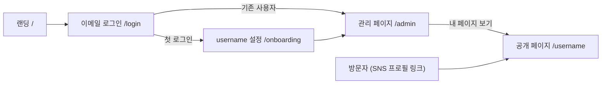
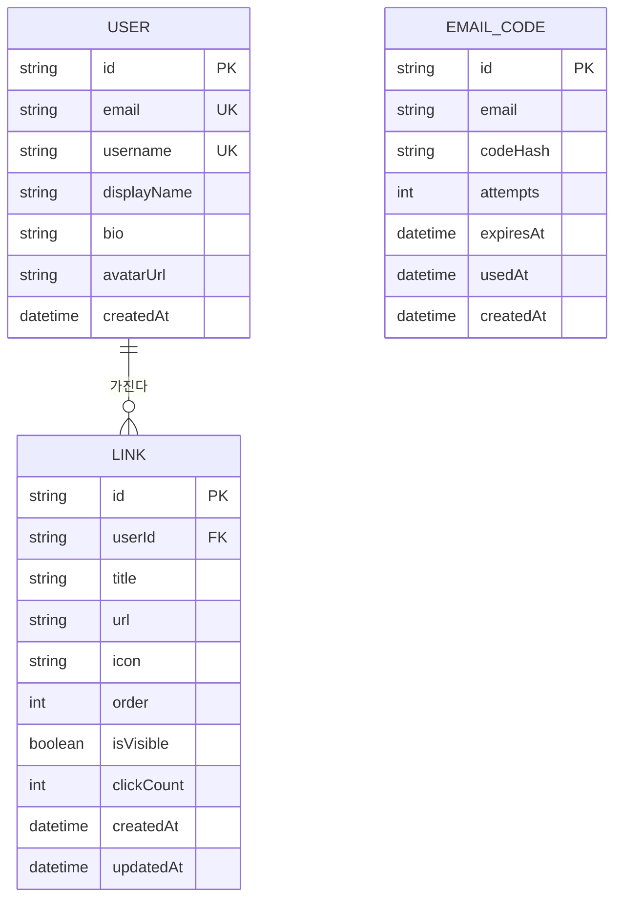

# 마이링크 (MyLink) — 기능정의서 (PRD)

> 링크트리(Linktree) 클론 서비스
> 문서 버전: v1.1 · 작성일: 2026-11-14 · 상태: 초안(Draft)
> v1.1 변경: 비밀번호 로그인 → 이메일 인증코드 로그인으로 변경

---

## 1. 프로젝트 개요

| 항목 | 내용 |
|---|---|
| **이름** | 마이링크 (MyLink) |
| **목적** | 여러 개의 링크(SNS, 블로그, 포트폴리오, 쇼핑몰 등)를 한 페이지에 모아 하나의 주소로 공유 |
| **대상** | SNS 사용자, 크리에이터, 인플루언서, 프리랜서, 소상공인 |
| **핵심** | 링크 CRUD (Create · Read · Update · Delete) + 개인 URL(`/username`) 공유 |
| **해결하는 문제** | 인스타그램·틱톡 등 프로필에 링크를 1개만 넣을 수 있는 제약 해소 |
| **기술 스택** | Next.js 16 (App Router) · React 19 · TypeScript · Tailwind CSS 4 |
| **디자인 기준** | [`design.md`](./design.md) (단일 액센트 블루 `#0066cc`, 필 버튼, 여백 중심 레이아웃) |

### 1.1 성공 지표 (KPI)

| 지표 | 목표 |
|---|---|
| 가입 후 첫 링크 추가까지 걸리는 시간 | 1분 이내 |
| 공개 페이지 로딩 시간 (LCP) | 2.5초 이내 |
| 링크 추가 성공률 (오류 없이 저장) | 95% 이상 |

---

## 2. 기능 목록

**우선순위 기준**
- **필수 (P0)**: MVP 출시에 반드시 필요한 기능
- **선택 (P1)**: MVP 이후 추가하면 좋은 부가 기능
- **선택 (P2)**: 향후 확장 기능

| ID | 구분 | 기능명 | 설명 | 우선순위 |
|---|---|---|---|---|
| F-01 | 링크 | 링크 목록 표시 | 등록한 링크를 순서대로 카드/버튼 형태로 표시 | **필수 (P0)** |
| F-02 | 링크 | 링크 추가 | 제목·URL·아이콘을 입력받아 목록에 추가 | **필수 (P0)** |
| F-03 | 링크 | 링크 수정 | 기존 링크의 제목·URL·아이콘 변경 | **필수 (P0)** |
| F-04 | 링크 | 링크 삭제 | 확인 후 링크 삭제 | **필수 (P0)** |
| F-05 | 공유 | 개인 URL (`/username`) | 사용자별 고유 공개 페이지 제공 | **필수 (P0)** |
| F-06 | 계정 | 이메일 인증 로그인 | 비밀번호 없이 이메일 인증코드만으로 가입·로그인 | **필수 (P0)** |
| F-07 | 프로필 | 프로필 영역 (이름, 소개) | 공개 페이지 상단에 이름·소개 표시 및 편집 | 선택 (P1) |
| F-08 | 프로필 | 프로필 이미지 | 아바타 이미지 업로드 | 선택 (P1) |
| F-09 | 링크 | 링크 순서 변경 | 드래그 앤 드롭으로 순서 변경 | 선택 (P1) |
| F-10 | 링크 | 링크 공개/숨김 토글 | 삭제하지 않고 공개 페이지에서만 숨김 | 선택 (P1) |
| F-11 | 공유 | URL 복사 / QR 코드 | 내 페이지 주소 복사, QR 코드 생성 | 선택 (P1) |
| F-12 | 꾸미기 | 테마 변경 | 라이트/다크, 배경색, 버튼 스타일 선택 | 선택 (P2) |
| F-13 | 통계 | 클릭 수 집계 | 링크별 클릭 수 확인 | 선택 (P2) |

---

## 3. 화면 구성 및 라우팅

| 경로 | 화면 | 접근 권한 | 설명 |
|---|---|---|---|
| `/` | 랜딩 페이지 | 누구나 | 서비스 소개, `시작하기` 버튼 |
| `/login` | 이메일 로그인 | 비로그인 | ① 이메일 입력 → ② 인증코드 6자리 입력 (가입·로그인 공용) |
| `/onboarding` | username 설정 | 첫 로그인 사용자 | 처음 로그인한 사용자만 username 지정 |
| `/admin` | 관리(편집) 페이지 | 로그인 사용자 본인 | 링크 CRUD, 프로필 편집, 미리보기 |
| `/[username]` | 공개 페이지 | 누구나 | 프로필 + 링크 목록 (읽기 전용) |



---

## 4. 상세 기능 정의

### F-01. 링크 목록 표시 — 필수 (P0)

| 항목 | 내용 |
|---|---|
| **설명** | 사용자가 등록한 링크를 지정된 순서대로 세로 목록으로 표시 |
| **동작 방식** | 페이지 진입 → 링크 데이터 조회 → `order` 오름차순 정렬 → 카드 목록 렌더링 |
| **입력** | `username` (공개 페이지) 또는 로그인 세션 (관리 페이지) |
| **출력** | 링크 카드 목록 (아이콘 + 제목). 공개 페이지에서 카드 클릭 시 새 탭으로 URL 이동 |
| **관리 페이지 차이** | 각 카드에 `수정` · `삭제` 버튼 표시 |
| **예외 처리** | • 링크가 0개: 관리 페이지 → "첫 링크를 추가해 보세요" 안내 + 추가 버튼 강조 / 공개 페이지 → "아직 등록된 링크가 없습니다" 표시<br>• 데이터 조회 실패: "링크를 불러오지 못했습니다. 다시 시도" 버튼 표시 |

### F-02. 링크 추가 — 필수 (P0)

| 항목 | 내용 |
|---|---|
| **설명** | 제목, URL, 아이콘을 입력받아 목록에 새 링크 추가 |
| **동작 방식** | `+ 링크 추가` 버튼 클릭 → 입력 폼 표시 → 값 입력 → `저장` 클릭 → 유효성 검사 → 저장 → 목록 갱신 (맨 아래에 추가) → 폼 닫힘 + "링크가 추가되었습니다" 토스트 |
| **취소** | `취소` 버튼 또는 `Esc` 키 → 입력값 버리고 폼 닫힘 |

**입력 항목**

| 필드 | 타입 | 필수 | 규칙 | 예시 |
|---|---|---|---|---|
| 제목 | 텍스트 | ✅ | 1~50자, 앞뒤 공백 제거 | `내 인스타그램` |
| URL | 텍스트 | ✅ | `http://` 또는 `https://`로 시작하는 올바른 URL, 최대 2,048자 | `https://instagram.com/myid` |
| 아이콘 | 선택 목록 | ❌ | 미리 정의된 아이콘 중 선택 (기본값: 🔗 링크) | Instagram, YouTube, GitHub, Blog, Email, Link |

**출력**: 목록 맨 아래에 새 링크 카드 추가

**예외 처리**

| 상황 | 처리 |
|---|---|
| URL 형식 오류 | 입력창 테두리 **빨간색** + 입력창 아래 빨간 글씨 "올바른 URL 형식이 아닙니다 (예: https://example.com)" |
| 프로토콜 누락 (`instagram.com/myid`) | 자동으로 `https://`를 앞에 붙여 보정 후 다시 검사 |
| 제목 미입력 | 입력창 빨간색 + "제목을 입력해 주세요" |
| 제목 50자 초과 | 입력 제한 + 글자 수 카운터(`50/50`) 빨간색 |
| `javascript:`, `data:` 등 위험 스킴 | 저장 거부 + "허용되지 않는 URL입니다" |
| 링크 개수 최대치(50개) 초과 | 추가 버튼 비활성화 + "링크는 최대 50개까지 등록할 수 있습니다" |
| 저장 중 네트워크 오류 | 입력값 유지 + "저장에 실패했습니다. 다시 시도해 주세요" |
| 저장 버튼 중복 클릭 | 저장 중에는 버튼 비활성화 + 로딩 표시 |

> 유효성 검사 시점: 입력창에서 포커스가 빠질 때(blur) 1차 검사, `저장` 클릭 시 최종 검사. 오류가 있으면 저장되지 않음.

### F-03. 링크 수정 — 필수 (P0)

| 항목 | 내용 |
|---|---|
| **설명** | 등록된 링크의 제목·URL·아이콘 변경 |
| **동작 방식** | 링크 카드의 `수정` 버튼 클릭 → 기존 값이 채워진 입력 폼 표시 → 값 변경 → `저장` → 유효성 검사 → 저장 → 해당 카드만 갱신 → "수정되었습니다" 토스트 |
| **입력** | F-02와 동일 (기존 값 미리 채움) |
| **출력** | 수정된 내용이 반영된 링크 카드 (순서는 유지) |
| **예외 처리** | • 유효성 오류: F-02와 동일 (빨간색 경고)<br>• 변경 사항 없음: `저장` 버튼 비활성화<br>• 수정 중 취소: 변경 내용 버리고 원래 값 유지<br>• 이미 삭제된 링크: "존재하지 않는 링크입니다" 안내 후 목록 새로고침 |

### F-04. 링크 삭제 — 필수 (P0)

| 항목 | 내용 |
|---|---|
| **설명** | 등록된 링크를 목록에서 제거 |
| **동작 방식** | `삭제` 버튼 클릭 → 확인 대화상자 "'{제목}' 링크를 삭제할까요?" → `삭제` 클릭 → 목록에서 제거 → "삭제되었습니다 · 실행 취소" 토스트 (5초) |
| **입력** | 삭제할 링크 ID |
| **출력** | 해당 링크가 제거된 목록 |
| **예외 처리** | • 확인 대화상자에서 `취소`: 아무 변화 없음<br>• 삭제 실패: 목록 원상복구 + "삭제에 실패했습니다" 안내<br>• 실행 취소 클릭: 원래 위치로 복원 |

### F-05. 개인 URL (`/username`) — 필수 (P0)

| 항목 | 내용 |
|---|---|
| **설명** | 사용자마다 `mylink.app/username` 형태의 고유 공개 페이지 제공 |
| **동작 방식** | 방문자가 `/{username}` 접속 → username으로 사용자 조회 → 프로필 + 공개 링크 목록 렌더링 |
| **입력** | URL 경로의 `username` |
| **출력** | 읽기 전용 공개 페이지 (프로필 영역 + 링크 목록 + 하단 "MyLink로 나만의 페이지 만들기" 배너) |

**username 규칙**

| 규칙 | 내용 |
|---|---|
| 길이 | 3~20자 |
| 허용 문자 | 영문 소문자, 숫자, 밑줄(`_`), 마침표(`.`) |
| 중복 | 불가 (대소문자 구분 없이 고유) |
| 예약어 | `admin`, `login`, `signup`, `api`, `settings`, `about` 등 시스템 경로 사용 불가 |

**예외 처리**

| 상황 | 처리 |
|---|---|
| 존재하지 않는 username | 404 페이지 "페이지를 찾을 수 없습니다" + 홈으로 가기 버튼 |
| username 설정 시 중복 | 입력창 빨간색 + "이미 사용 중인 이름입니다" (입력 중 실시간 확인) |
| 규칙 위반 username | 입력창 빨간색 + 위반한 규칙 안내 |
| 대문자로 접속 (`/MyName`) | 소문자 경로(`/myname`)로 리다이렉트 |

### F-06. 이메일 인증 로그인 — 필수 (P0)

| 항목 | 내용 |
|---|---|
| **설명** | 비밀번호 없이 **이메일로 받은 6자리 인증코드**만으로 로그인. 가입과 로그인을 하나의 화면으로 통합 (처음 쓰는 이메일이면 자동으로 계정 생성) |
| **동작 방식** | ① `/login`에서 이메일 입력 → `인증코드 받기` 클릭<br>② 서버가 6자리 코드를 생성해 메일 발송 → 화면이 코드 입력 단계로 전환<br>③ 메일로 받은 코드 입력 → `확인` 클릭 → 코드 검증<br>④ 성공 시 세션 발급 → **기존 사용자**는 `/admin`, **첫 로그인 사용자**는 `/onboarding`에서 username 설정 후 `/admin` 이동<br>로그아웃: 세션 삭제 → `/` 이동 |
| **입력** | 이메일 / 인증코드(숫자 6자리) / username (첫 로그인 시 1회) |
| **출력** | 인증 메일 (제목: "[마이링크] 로그인 인증코드: 123456"), 로그인 세션 (HttpOnly 쿠키, 유효기간 30일) |

**인증코드 규칙**

| 규칙 | 내용 |
|---|---|
| 형식 | 숫자 6자리 |
| 유효 시간 | 발송 후 10분 (화면에 남은 시간 표시 `09:59`) |
| 사용 횟수 | 1회 사용 후 즉시 폐기 |
| 재발송 | 60초 후 `코드 다시 받기` 가능, 재발송 시 이전 코드는 무효 |
| 입력 시도 | 코드 1개당 최대 5회 오입력 시 무효 → 새 코드 요청 필요 |

**예외 처리**

| 상황 | 처리 |
|---|---|
| 이메일 형식 오류 | 입력창 빨간색 + "올바른 이메일 형식이 아닙니다" |
| 인증코드 불일치 | 입력창 빨간색 + "인증코드가 올바르지 않습니다 (남은 시도 4회)" |
| 인증코드 만료 | "인증코드가 만료되었습니다. 코드를 다시 받아 주세요" + 재발송 버튼 강조 |
| 5회 오입력 | 코드 무효화 + "시도 횟수를 초과했습니다. 코드를 다시 받아 주세요" |
| 메일이 오지 않음 | 안내 문구 "스팸함을 확인하거나 60초 후 다시 받아 주세요" + 이메일 다시 입력 링크 |
| 메일 발송 실패 | "메일을 보내지 못했습니다. 잠시 후 다시 시도해 주세요" |
| 비로그인 상태로 `/admin` 접근 | `/login`으로 리다이렉트 (로그인 후 원래 페이지로 복귀) |
| username 미설정 상태로 `/admin` 접근 | `/onboarding`으로 리다이렉트 |

### F-07. 프로필 영역 (이름, 소개) — 선택 (P1)

| 항목 | 내용 |
|---|---|
| **설명** | 공개 페이지 최상단에 표시되는 사용자 소개 영역 |
| **동작 방식** | 관리 페이지의 프로필 섹션에서 `편집` 클릭 → 이름·소개 입력 → `저장` → 미리보기 및 공개 페이지에 즉시 반영 |
| **입력** | 이름 (1~30자, 필수) / 소개 (0~150자, 선택, 줄바꿈 허용) |
| **출력** | 공개 페이지 상단: 아바타 → 이름 → `@username` → 소개 순서로 가운데 정렬 표시 |
| **예외 처리** | • 이름 미입력: 빨간색 경고 "이름을 입력해 주세요"<br>• 글자 수 초과: 입력 제한 + 카운터 빨간색<br>• 이름 미설정 상태: 공개 페이지에 `@username`을 대신 표시 |

### F-08 ~ F-13. 선택 기능 요약

| ID | 기능 | 동작 방식 | 예외 처리 |
|---|---|---|---|
| F-08 | 프로필 이미지 | 아바타 클릭 → 파일 선택 → 미리보기 → 저장 | JPG/PNG/WebP만 허용, 2MB 초과 시 빨간색 경고. 미등록 시 이름 첫 글자 기본 아바타 |
| F-09 | 순서 변경 | 카드 핸들(⋮⋮) 드래그 → 놓기 → 순서 자동 저장 | 저장 실패 시 이전 순서로 복원. 키보드(↑↓)로도 이동 가능 |
| F-10 | 공개/숨김 토글 | 카드의 토글 스위치 클릭 → 즉시 저장 | 숨김 링크는 관리 페이지에서 흐리게 표시 |
| F-11 | URL 복사 / QR | `복사` 클릭 → 클립보드 복사 → "복사되었습니다" / `QR` 클릭 → QR 이미지 표시·다운로드 | 클립보드 권한 없음 → 주소를 선택 상태로 표시 |
| F-12 | 테마 변경 | 테마 선택 → 미리보기 → 저장 | 글자/배경 대비가 부족한 조합은 경고 |
| F-13 | 클릭 통계 | 공개 페이지에서 링크 클릭 시 카운트 증가 → 관리 페이지에서 확인 | 본인 클릭·봇 클릭은 집계 제외 |

---

## 5. 데이터 모델



```ts
// 참고용 TypeScript 타입
interface Link {
  id: string;
  userId: string;
  title: string;      // 1~50자
  url: string;        // http(s):// 만 허용
  icon: LinkIcon;     // 기본값 "link"
  order: number;      // 표시 순서 (오름차순)
  isVisible: boolean; // 기본값 true (P1)
  createdAt: string;
  updatedAt: string;
}

type LinkIcon = "link" | "instagram" | "youtube" | "github" | "blog" | "email" | "x" | "tiktok";
```

---

## 6. 비기능 요구사항

### 6.1 성능

| 항목 | 기준 |
|---|---|
| 공개 페이지 로딩 | LCP 2.5초 이내 (4G 모바일 기준), Lighthouse 성능 점수 90점 이상 |
| 렌더링 방식 | 공개 페이지는 서버 렌더링(SSR/ISR)으로 첫 화면을 빠르게 표시, 링크 수정 시 해당 페이지 캐시 갱신 |
| 링크 CRUD 응답 | 저장/수정/삭제 API 응답 500ms 이내, 화면은 낙관적 업데이트(Optimistic UI)로 즉시 반영 |
| 이미지 | `next/image`로 자동 최적화(WebP, 지연 로딩) |
| 번들 크기 | 공개 페이지 JS 100KB(gzip) 이하 |

### 6.2 보안

| 항목 | 기준 |
|---|---|
| 인증 | 비밀번호 없이 이메일 인증코드 방식 사용. 인증코드는 암호학적 난수로 생성하고 **해시로 저장**(평문 저장 금지), 10분 만료·1회용. 세션은 HttpOnly · Secure · SameSite 쿠키 |
| 권한 | 링크 생성·수정·삭제 시 서버에서 **요청자 = 링크 소유자** 여부를 반드시 검증 |
| 입력 검증 | 클라이언트 + 서버 이중 검증. 서버에서 길이·형식 재검사 |
| URL 안전성 | `http`, `https`(및 `mailto`)만 허용, `javascript:` · `data:` 등 차단 |
| XSS 방지 | 사용자 입력은 이스케이프하여 출력, HTML 직접 삽입(`dangerouslySetInnerHTML`) 금지 |
| 외부 링크 | `target="_blank"` 링크에 `rel="noopener noreferrer"` 적용 |
| 요청 제한 | 인증코드 발송은 같은 이메일당 60초 1회 · 1시간 5회, 같은 IP당 1시간 20회로 제한. 코드 오입력 5회 시 무효화. API 요청 횟수 제한(Rate Limit) |
| 메일 발송 | 트랜잭션 메일 서비스(예: Resend, AWS SES) 사용, SPF·DKIM 설정으로 스팸 분류 방지 |
| 전송 | 전 구간 HTTPS |
| 개인정보 | 공개 페이지에 이메일 등 비공개 정보 노출 금지 |

### 6.3 사용성 · 접근성

| 항목 | 기준 |
|---|---|
| 반응형 | 모바일 우선 설계 (360px ~ 1440px), 공개 페이지 콘텐츠 최대 폭 680px |
| 터치 영역 | 버튼·링크 카드 최소 44 × 44px |
| 접근성 | WCAG 2.1 AA 준수: 명도 대비 4.5:1 이상, 키보드만으로 모든 기능 사용 가능, 포커스 링 표시, 아이콘 버튼에 `aria-label` |
| 오류 표시 | 빨간색 + 텍스트 메시지를 함께 사용 (색만으로 오류를 전달하지 않음), `aria-invalid` · `aria-describedby` 적용 |
| 피드백 | 저장·삭제 등 모든 작업 결과를 토스트로 안내 |

### 6.4 호환성 · 유지보수

| 항목 | 기준 |
|---|---|
| 브라우저 | Chrome, Safari, Edge, Firefox 최신 2개 버전 / iOS Safari, Android Chrome / 인스타그램·카카오톡 인앱 브라우저 |
| SEO · 공유 | 공개 페이지별 `title`, `description`, Open Graph 이미지 설정 (SNS 공유 시 미리보기 표시) |
| 코드 품질 | TypeScript strict 모드, ESLint 통과 |
| 가용성 | 월 가동률 99.5% 이상 |

---

## 7. 디자인 가이드 (요약)

[`design.md`](./design.md)를 따른다.

| 요소 | 적용 |
|---|---|
| 액센트 색상 | Action Blue `#0066cc` — 추가·저장 버튼, 링크 등 모든 인터랙션 요소 |
| 오류 색상 | Error Red `#e30000` — 유효성 오류 테두리 및 메시지 (design.md에 없는 상태값으로 본 문서에서 추가 정의) |
| 배경 | 공개 페이지 Parchment `#f5f5f7`, 링크 카드 White `#ffffff` |
| 링크 카드 | 둥근 모서리 18px, 1px 헤어라인 테두리, 그림자 없음 |
| 버튼 | 주요 CTA는 필(pill) 형태, 눌림 시 `scale(0.95)` |
| 글꼴 | `system-ui, -apple-system` (비 Apple 환경은 Inter / Pretendard) |

---

## 8. 범위 외 (Out of Scope, v1.0)

- 유료 구독 / 결제 기능
- 커스텀 도메인 연결
- 팀(다중 사용자) 계정
- 비밀번호 로그인 (이메일 인증코드 방식으로 대체)
- 소셜 로그인(Google, Kakao) — v1.1 검토

---

## 9. 수용 기준 (Acceptance Criteria) — MVP

- [ ] 이메일을 입력하면 6자리 인증코드 메일이 발송되고, 코드를 입력하면 로그인된다.
- [ ] 처음 로그인한 사용자는 username을 설정해야 하며, 설정한 username으로 `/username` 공개 페이지에 접속할 수 있다.
- [ ] 틀리거나 만료된 인증코드를 입력하면 빨간색 경고가 표시되고 로그인되지 않는다.
- [ ] `+ 링크 추가` → 폼 입력 → `저장` 시 목록 맨 아래에 새 링크가 나타난다.
- [ ] 잘못된 URL을 입력하면 입력창이 빨간색으로 바뀌고 오류 문구가 표시되며 저장되지 않는다.
- [ ] 링크 수정 후 저장하면 관리 페이지와 공개 페이지 모두에 변경 내용이 반영된다.
- [ ] 링크 삭제 시 확인 대화상자가 표시되고, 확인 후 목록에서 사라진다.
- [ ] 로그인하지 않은 사용자나 다른 사용자는 내 링크를 수정·삭제할 수 없다.
- [ ] 존재하지 않는 username으로 접속하면 404 페이지가 표시된다.
- [ ] 공개 페이지의 링크를 클릭하면 새 탭에서 해당 URL이 열린다.
