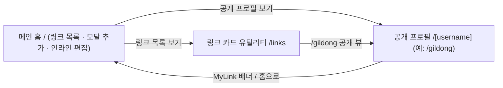

# 마이링크 (MyLink) — 기능정의서 (PRD)

> 링크트리(Linktree) 클론 서비스 — 멀티 링크 & 바이오 프로필 서비스
> 문서 버전: v3.10 · 작성일: 2026-11-15 · 상태: 확정(Confirmed)
> v3.10 변경: **가로 400px 이하(모바일 미니)** 좁은 화면에서 `LinkCard` 텍스트가 말줄임표(`...`)로 잘리는 현상을 방지하기 위해, **400px 이하에서는 텍스트·배지·화살표를 숨기고 대표 아이콘(`LinkGlyph`)만 중앙에 표시**하는 반응형 규칙을 `F-01`, `6.3`, `7.2`, `9`에 추가
> v3.9 변경: 프라이머리 CTA 버튼(`+ 링크 추가`, 다이얼로그/인라인 `저장`) 색상을 **애플 모노톤 다크 그레이(`#1d1d1f` / `--primary`)** 로 전환하고 깔끔한 둥근 모서리(`rounded-full`)·은은한 그림자 스타일을 반영. `F-02` 링크 추가 다이얼로그(`AddLinkDialog`)에 **`Zod` + `React Hook Form`(`@hookform/resolvers/zod`)** 검증 규칙(`'제목을 입력해 주세요'`, `'올바른 URL 형식이 아닙니다'`, 통과 시 입력 칸 자동 초기화) 명세 추가
> v3.8 변경: 별도의 `/admin` 관리자 페이지·대시보드 및 임시 데모 계정(`@gildong`) 자동 세션·가짜 로그인(`/login`, `/onboarding`) 우회 스펙을 완전히 제거하고, **강의 표준 7주차 요구사항**에 맞춰 재정렬. 링크 목록 관리(모달 다이얼로그 `AddLinkDialog` 추가·인라인 편집·삭제)는 **메인 페이지(루트 `/`)** 에서 직접 수행하며, 현재 7주차 단계에서는 서버 연동 없이 **브라우저 로컬 메모리 상태(`React useState`)** 로 링크를 관리함을 명시
> v3.7 변경: `F-02` 링크 추가 폼을 **다이얼로그(`shadcn/ui Dialog`)** 방식으로 확정하고 Action Blue(`#0066cc`) CTA 기준 정렬
> v3.6 변경: 전체 스타일링을 CSS Modules(`.module.css`) 없이 **Tailwind CSS 4**(`app/globals.css`) 단일 체계로 통일하고, **shadcn/ui (`Card`, `Badge`, `Button`, `Separator`) 기반 공용 `LinkCard` (`app/components/LinkCard.tsx`)** 재사용 아키텍처 반영
> v3.5 변경: 링크 목록 페이지(`/links`) 및 기본 더미 데이터(`app/links/links-data.ts`의 `dummyLinks` 6종 · `linkListProfile`) 사용 명세를 라우팅, 데이터 모델, 폴더 설계에 반영
> v3.4 변경: UI 컴포넌트 구현 기반을 **shadcn/ui (`https://ui.shadcn.com/create`)** + **Tailwind CSS 4 (CSS-first, `tailwind.config` 파일 미사용)** 로 정의하고, [`design.md`](../design.md)를 Apple 디자인 시스템 기준서로 유지·연동하는 원칙 명시

---

## 1. 프로젝트 개요

| 항목 | 내용 |
|---|---|
| **이름** | 마이링크 (MyLink) |
| **목적** | 개인 크리에이터 및 일반 사용자가 여러 개의 링크(SNS, 블로그, 포트폴리오, 쇼핑몰 등)와 프로필을 한 페이지에 모아 공유하는 **멀티 링크 & 바이오 프로필 서비스** |
| **대상** | 개인 크리에이터, SNS 사용자, 일반 사용자, 인플루언서, 프리랜서, 소상공인 |
| **핵심** | **메인 페이지(루트 `/`)** 상단 프라이머리 `링크 추가` 버튼 기반 **모달(다이얼로그) 링크 추가 + 카드 인라인 편집·삭제**, 공용 링크 목록 뷰(`/links`), 개인 공개 프로필(`/[username]`, `/gildong`) |
| **해결하는 문제** | 인스타그램·틱톡 등 SNS 프로필에 링크를 1개만 넣을 수 있는 제약 해소 |
| **구현 형태 (7주차)** | **서버·DB·임시 세션 연동 없이 브라우저 로컬 메모리 상태(`React useState`)로 동작하는 프론트엔드 애플리케이션** — 루트(`/`)에서 `dummyLinks` 초기 시드를 불러와 모달 추가·인라인 편집·삭제 시 목록에 즉시 반영됨 (새로고침 시 초기 목록으로 복원, 향후 주차에 서버/DB API 연동 예정) |
| **기술 스택** | Next.js 16 (App Router) · React 19 · TypeScript · **Tailwind CSS 4** (CSS-first, `app/globals.css` 단일 스타일시트 — CSS Modules `.module.css` 미사용) · **shadcn/ui** ([`https://ui.shadcn.com/create`](https://ui.shadcn.com/create), `@base-ui/react`, `lucide-react`) · **React Hook Form + Zod** (`@hookform/resolvers/zod`) · React `useState` (루트 `/` 링크 로컬 메모리 상태) · Zustand 5 (`/[username]` 공개 프로필 조회용) |
| **디자인 기준** | **컴포넌트 기반**: [`shadcn/ui`](https://ui.shadcn.com/create) 기반으로 UI 프리미티브와 재사용 링크 컴포넌트(`app/components/LinkCard.tsx`)·모달(`app/components/AddLinkDialog.tsx`) 구축<br>**시각 시스템**: [`design.md`](../design.md) 기반 **Apple 디자인 시스템** 스타일 구축 (모노톤 다크 그레이 `#1d1d1f` 프라이머리 CTA 버튼 · 둥근 모서리 & 은은한 그림자, 다크 타일 위 `#2997ff`, 18px 카드, 상단 라이트/하단 다크 풀블리드 타일 교차, SF Pro + Inter/Noto Sans KR 위계) |

### 1.1 성공 지표 (KPI)

| 지표 | 목표 |
|---|---|
| 홈(`/`) 진입 후 모달을 통해 첫 링크를 로컬 목록에 추가하는 시간 | 30초 이내 |
| 루트(`/`) 및 공개 페이지 초기 화면 렌더링 (LCP) | 2.5초 이내 |
| 링크 추가·인라인 편집 성공률 (유효성 안내 포함 오류 없이 반영) | 95% 이상 |

---

## 2. 기능 목록

**우선순위 기준**
- **필수 (P0)**: 현재 7주차 표준 요구사항에 포함되는 핵심 기능
- **선택 (P1)**: 사용성을 높이는 부가 기능
- **확장 (P2)**: 향후 실제 백엔드·인증·DB 연동 주차에서 확장할 기능

| ID | 구분 | 기능명 | 설명 | 우선순위 |
|---|---|---|---|---|
| F-01 | 링크 | 링크 목록 표시 | 루트(`/`)·`/links`·`/[username]`에서 등록된 링크를 `LinkCard` 형태로 순서대로 표시 | **필수 (P0)** |
| F-02 | 링크 | 모달 링크 추가 | 루트(`/`) 상단 모노톤 다크 그레이(`#1d1d1f`) `링크 추가` 버튼 → **`shadcn/ui Dialog` 모달**에서 **Zod + React Hook Form** 검증을 거쳐 제목·URL·아이콘(도메인 자동 추천)을 로컬 메모리(`useState`)에 즉시 추가 및 입력 칸 초기화 | **필수 (P0)** |
| F-03 | 링크 | 인라인 링크 수정 | 루트(`/`) 링크 목록 카드의 `수정` 버튼을 눌러 해당 항목을 인라인 편집 폼으로 전환해 제목·URL(아이콘 자동 매칭) 즉시 수정 | **필수 (P0)** |
| F-04 | 링크 | 링크 삭제 | 루트(`/`) 링크 목록 카드의 `삭제` 버튼 클릭 시 브라우저 로컬 메모리 목록에서 즉시 제거 | **필수 (P0)** |
| F-05 | 공유 | 개인 URL (`/[username]`) | 사용자별 고유 공개 프로필 뷰 (`/gildong` 예시 포함, 대문자/이전 주소 리다이렉트 및 404 처리) | **필수 (P0)** |
| F-06 | 프로필 | 프로필 및 공부/작품 소개 | 루트(`/`) 상단 프로필(아바타·이름·소개)·공부 기록·연습 작품 쇼케이스 표시 | **필수 (P0)** |
| F-07 | UI | URL 안전성 및 도메인 아이콘 추천 | `http://`, `https://`, `mailto:`만 허용하고 도메인별 13종 아이콘을 자동 추천 | **필수 (P0)** |
| F-08 | 링크 | 링크 순서 변경 | 목록 내 링크 순서 드래그 앤 드롭 또는 `▲`/`▼` 이동 버튼 지원 | 선택 (P1) |
| F-09 | UI | 테마 프리셋 및 버튼 스타일 | 카드형(`18px`) / 필형(`9999px`) 및 라이트/다크 테마 전환 | 선택 (P1) |
| F-10 | 공유 | URL 복사 / QR 코드 | 공개 프로필 주소 원클릭 복사 (`페이지 공유` 버튼 구현됨) | 선택 (P1) |
| F-11 | 확장 | 실제 서버 · DB · 로그인 인증 연동 | 향후 백엔드 API, DB 영속화, 실제 사용자 세션 인증 연동 (별도 세션 우회/데모 자동 로그인 미사용) | 확장 (P2) |

---

## 3. 화면 구성 및 라우팅

> 화면별 상세 텍스트 와이어프레임: [WIREFRAME.md](./WIREFRAME.md)

| 경로 | 화면 | 접근 권한 | 설명 |
|---|---|---|---|
| `/` | 메인 페이지 (프로필 & 링크 관리 홈) *(구현됨)* | 누구나 | 프로필 소개 히어로 + **상단 모노톤 다크 그레이(`#1d1d1f`, 둥근 모서리 & 은은한 그림자) `링크 추가` 프라이머리 버튼** + **`내 링크 목록` (브라우저 로컬 메모리 상태 `useState`, 모달 추가 `AddLinkDialog` · 카드 인라인 편집 · 삭제)** + 공부 기록/연습 작품 타일 + 연락처 푸터 |
| `/links` | 링크 목록 전용 유틸리티 페이지 *(구현됨)* | 누구나 | Apple 유틸리티 카드(`18px`, 모노톤 다크 그레이 `#1d1d1f` CTA) 기반 중앙 정렬 페이지. 공용 `LinkCard`(`shadcn/ui Card`) 재사용, [`app/links/links-data.ts`](../app/links/links-data.ts)의 `dummyLinks` 6종 및 `linkListProfile` 사용 |
| `/[username]` | 공개 프로필 페이지 *(구현됨)* | 누구나 | 프로필(아바타·이름·소개) + 소셜 미디어 아이콘 배치 + 섹션 구분 헤더 + 공용 `LinkCard` 링크 목록 (`PublicProfileView` 기반). `/gildong` 기본 시드, 대문자/이전 username 리다이렉트 및 404 처리 포함 (세션 자동 주입 없음) |



---

## 4. 상세 기능 정의

### F-01. 링크 목록 표시 — 필수 (P0)

| 항목 | 내용 |
|---|---|
| **설명** | 사용자가 등록한 기본 URL 링크를 공용 `LinkCard`(`shadcn/ui Card`) 목록으로 표시 |
| **동작 방식** | • **루트(`/`)**: 클라이언트 마운트 시 `dummyLinks` 6건으로 **브라우저 로컬 메모리 상태(`React useState`)** 를 초기화하고, 모달 추가·인라인 수정·삭제 결과를 즉시 목록에 반영<br>• **`/links`**: `app/links/links-data.ts`의 `dummyLinks` 정적 유틸리티 카드 표시<br>• **`/[username]`**: `PublicProfileView`를 통해 공개 프로필 섹션·링크 카드 표시<br>• **모바일 미니 반응형(`≤ 400px`)**: 가로 폭이 400px 이하로 줄어들면 말줄임표(`...`) 발생을 막기 위해 제목·카테고리 배지·URL 텍스트·우측 화살표를 시각적으로 숨기고(`min-[401px]:block`) **대표 아이콘(`LinkGlyph`)만 카드 중앙에 표시** (`aria-label`·`title` 접근성 유지) |
| **예외 처리** | 루트(`/`) 목록 항목이 0개일 때: `"등록된 링크가 없습니다"` 빈 상태 안내 문구 및 상단 `링크 추가` CTA 안내 표시 |

### F-02. 모달 링크 추가 (`AddLinkDialog`) — 필수 (P0)

| 항목 | 내용 |
|---|---|
| **설명** | 루트(`/`) 상단의 애플 모노톤 다크 그레이(`#1d1d1f`) 프라이머리 `링크 추가` 버튼을 통해 **모달 다이얼로그(`shadcn/ui Dialog`)** 를 열고, **Zod + React Hook Form** 검증을 거쳐 제목·URL·아이콘을 브라우저 로컬 메모리 목록에 추가 |
| **동작 방식** | 루트(`/`) 상단 `링크 추가` 버튼 클릭 → **`shadcn/ui Dialog` 기반 `AddLinkDialog` 열림** → `zodResolver(addLinkFormSchema)` + `useForm`으로 입력 검증 → URL 입력/블러 시 프로토콜(`https://`) 자동 보정 및 도메인 맞춤 아이콘 자동 추천 → `저장` 클릭 → 검증 통과 시 **부모(`HomeLinkManager`)의 `React useState` 로컬 메모리 목록 끝에 새 항목 즉시 추가 · 폼 입력 칸 초기화(`reset()`)** → 다이얼로그 닫힘 + `"링크가 추가되었습니다 (제목)"` 토스트 |
| **취소** | `취소` 버튼, 닫기(`X`), 배경 클릭 또는 `Esc` 키 → `reset()`으로 입력값·오류 상태 초기화 후 다이얼로그 닫힘 |

**입력 항목**

| 필드 | 타입 | 필수 | 규칙 | 예시 |
|---|---|---|---|---|
| 제목 | 텍스트 | ✅ | 1~50자, 앞뒤 공백 제거 | `내 유튜브 채널` |
| URL | 텍스트 | ✅ | `http://`, `https://`, `mailto:` 스킴만 허용, 최대 2,048자 | `https://youtube.com/@mystudio`, `mailto:hello@example.com` |
| 아이콘 | 선택 목록 | ❌ | 13종 중 선택 (기본값: `link`). URL 입력 시 도메인·스킴 기반 자동 선택(수동 변경 가능) | `link`, `instagram`, `youtube`, `tiktok`, `x`, `threads`, `github`, `kakao`, `naver`, `blog`, `email`, `shop`, `portfolio` |

**아이콘 자동 추천 규칙**
- `instagram.com` → `instagram` / `youtube.com`, `youtu.be` → `youtube` / `tiktok.com` → `tiktok`
- `x.com`, `twitter.com` → `x` / `threads.net` → `threads` / `github.com` → `github`
- `kakao.com`, `open.kakao.com`, `pf.kakao.com` → `kakao` / `naver.com`, `blog.naver.com`, `smartstore.naver.com` → `naver`
- `velog.io`, `medium.com`, `tistory.com` → `blog` / `mailto:` → `email` / 기타 URL은 기본 `link`

**예외 처리**

| 상황 | 처리 |
|---|---|
| URL 형식 오류 / 빈 URL / 위험 스킴 | 입력창 테두리 **빨간색(`#e30000`)** + 아래 빨간 글씨 **`"올바른 URL 형식이 아닙니다"`** 및 제출 중단 |
| 프로토콜 누락 (`youtube.com/@mystudio`) | 포커스 아웃(blur) 또는 저장 시 자동으로 `https://`를 앞에 붙여 보정 후 검사 |
| `mailto:` 형식 오류 (`mailto:abc`) | 올바른 이메일 형식이 아니면 빨간색 경고 **`"올바른 URL 형식이 아닙니다"`** 및 제출 중단 |
| 제목 미입력 / 공백 | 입력창 빨간색 + **`"제목을 입력해 주세요"`** 및 제출 중단 |
| 제목 50자 초과 | 입력 제한 + 글자 수 카운터(`50/50`) 빨간색 |
| 최대 등록 수(50개) 초과 | 추가 버튼 비활성화 + `"항목은 최대 50개까지 등록할 수 있습니다"` |

### F-03. 인라인 링크 수정 — 필수 (P0)

| 항목 | 내용 |
|---|---|
| **설명** | 별도 페이지 이동 없이 루트(`/`) 링크 목록 카드 옆 `수정` 버튼을 눌러 **해당 행을 인라인 편집 폼으로 전환**해 수정 |
| **동작 방식** | 카드 우측 `수정`(연필 아이콘) 클릭 → 제목·URL `Input`이 채워진 인라인 폼 표시 → 수정 후 `저장` 클릭 → 유효성 검사 및 도메인 기반 아이콘 재추천 → 로컬 메모리 상태(`useState`) 즉시 갱신 및 `"링크가 수정되었습니다 (제목)"` 토스트 |
| **취소 / 예외** | `취소` 버튼 클릭 시 변경 버리고 일반 카드 복귀 · 제목/URL 오류 시 인라인 빨간 오류 메시지(`#e30000`) 표시 |

### F-04. 링크 삭제 — 필수 (P0)

| 항목 | 내용 |
|---|---|
| **설명** | 루트(`/`) 링크 목록 카드 옆 `삭제`(휴지통 아이콘) 버튼을 눌러 로컬 메모리 목록에서 해당 링크 제거 |
| **동작 방식** | `삭제` 버튼 클릭 → `links` 상태 배열에서 해당 항목 제거(편집 중이던 항목이면 편집 모드 함께 종료) → `"링크가 삭제되었습니다 (제목)"` 토스트 표시 |

### F-05. 개인 URL (`/[username]`) — 필수 (P0)

| 항목 | 내용 |
|---|---|
| **설명** | 사용자별 고유 공개 프로필 페이지(`/gildong` 등) 조회 및 대문자/과거 주소 자동 리다이렉트 |
| **동작 방식** | 방문자가 `/{username}` 접속 → 활성 `username` 조회 → 없으면 이전 `username` 이력 조회 후 리다이렉트 → 둘 다 없으면 404 안내 화면 |
| **예약어** | `admin`, `login`, `onboarding`, `links`, `api`, `auth`, `settings`, `about`, `demo`, `404`, `robots.txt`, `sitemap.xml` |

---

## 5. 상태 관리 및 데이터 구조 (7주차 로컬 메모리 기준)

### 5.1 루트(`/`) 링크 관리 상태 — 브라우저 로컬 메모리 (`React useState`)

- **현재 7주차 표준**: 별도 백엔드 API, DB, 또는 가짜 로그인/임시 데모 계정 세션(`ensureDemoSession`, `currentUserId`) 없이 **`HomeLinkManager.tsx` 내부의 React `useState<MyLinkItem[]>` 로컬 메모리 상태**로 링크 목록을 관리합니다.
- 초기 마운트 시 `app/links/links-data.ts`의 `dummyLinks`(6건)로 초기화되며, 모달(`AddLinkDialog`) 추가·인라인 수정·삭제 시 메모리 상태가 즉시 업데이트되어 화면에 반영됩니다. (서버 영속화가 없으므로 브라우저 새로고침 시 초기 목록 `dummyLinks` 6건으로 복원됩니다.)

| ID | 제목 (`title`) | URL (`url`) | 아이콘 (`icon`) | 카테고리 (`category`) |
|---|---|---|---|---|
| `link-github` | GitHub 공부 저장소 | `https://github.com/gildong-study` | `github` | 코드 |
| `link-blog` | 오늘의 개발 블로그 (TIL) | `https://velog.io/@gildong_study` | `blog` | 기록 |
| `link-portfolio` | 연습 프로젝트 모음집 | `https://gildong-lab.vercel.app` | `portfolio` | 작품 |
| `link-youtube` | 유튜브 코딩 브이로그 | `https://youtube.com/@gildong_dev` | `youtube` | 영상 |
| `link-instagram` | 인스타그램 개발 일상 | `https://instagram.com/gildong_study` | `instagram` | SNS |
| `link-email` | 응원 · 협업 이메일 보내기 | `mailto:hello@example.com` | `email` | 문의 |

### 5.2 공개 프로필 예시 뷰 (`/[username]`) 보조 타입 (`app/lib/types.ts` · `useMyLinkStore.ts`)

- 공개 프로필 쇼케이스(`/[username]`, `/gildong`)는 `PublicProfileView`의 테마 프리셋(`apple-classic`, `pure-light`, `midnight-dark`, `soft-blue`), 버튼 스타일(`card`, `pill`), 리다이렉트 이력(`usernameHistory`) 및 읽기 전용 방문·클릭 카운터를 유지합니다.
- 사용자 인증 세션(`currentUserId`)이나 자동 로그인 우회 로직은 포함하지 않습니다.

---

## 6. 비기능 요구사항

### 6.1 성능

| 항목 | 기준 |
|---|---|
| 초기 렌더링 속도 | 루트(`/`) 및 공개 페이지 LCP 2.5초 이내 (4G 모바일 기준) |
| UI 반응 속도 | React 로컬 상태(`useState`) 기반 추가·인라인 수정·삭제 시 지연 없이 즉시 목록 리렌더링 |
| 이미지 최적화 | 정적 이미지는 `next/image`로 최적화 |

### 6.2 보안 및 데이터 안정성

| 항목 | 기준 |
|---|---|
| XSS 방지 | 사용자 입력(링크 제목, URL 등)은 React 기본 이스케이프로 출력하고 `dangerouslySetInnerHTML` 사용 금지 |
| URL 안전성 | `http://`, `https://`, `mailto:` 스킴만 허용하고 `javascript:`, `data:`, `vbscript:` 등 악성 스크립트 URL 차단 (`resolveSafeHref`) |
| 외부 링크 보호 | `http`/`https` 외부 링크에 `target="_blank" rel="noopener noreferrer"` 적용 |
| 7주차 로컬 상태 고지 | 현재 7주차 단계는 서버 연동 없는 브라우저 로컬 메모리 상태이며 민감한 개인정보·비밀번호 입력 불필요 |

### 6.3 사용성 · 접근성

| 항목 | 기준 |
|---|---|
| 반응형 | 모바일 우선 설계 (320px ~ 1440px), 링크 관리 목록 최대 폭 680px. **가로 400px 이하(`≤ 400px`)에서는 `LinkCard` 말줄임표(`...`)를 방지하기 위해 텍스트 없이 대표 아이콘만 중앙 표시** |
| 터치 영역 | 버튼·링크 카드 최소 높이 44px 이상 (`min-h-11`) |
| 접근성 | WCAG 2.1 AA 명도 대비 4.5:1 이상, 포커스 링(`#0071e3`), 아이콘 버튼 `aria-label` 필수 |
| 오류 표시 | 빨간색(`#e30000`) + 텍스트 메시지를 함께 사용, `aria-invalid` · `aria-describedby` 적용 |
| 피드백 | 링크 추가·인라인 수정·삭제 결과를 `role="status"` 플로팅 토스트로 안내 |

---

## 7. 디자인 시스템 및 UI 구현 전략

UI 컴포넌트 개발은 **[shadcn/ui (`https://ui.shadcn.com/create`)](https://ui.shadcn.com/create)** 를 기반으로 진행하며, 브랜드·시각적 완성도는 **[`design.md`](../design.md)** 에 정의된 **Apple 디자인 시스템** 기준으로 구축합니다.

### 7.1 역할 분리: shadcn/ui (컴포넌트 기반) + Apple 시스템 (`design.md`)

| 구분 | 기준 | 적용 범위 및 원칙 |
|---|---|---|
| **UI 컴포넌트 아키텍처** | **shadcn/ui** ([`https://ui.shadcn.com/create`](https://ui.shadcn.com/create)) | • 모든 UI 프리미티브(`Alert`, `Badge`, `Button`, `Card`, `Dialog`, `Input`, `Label`, `Select`, `Separator`, `Switch`, `Tabs`, `Textarea`, `Tooltip`)는 `components/ui/*`(`base-nova` 프리셋 · `@base-ui/react` · `lucide-react`) 기반으로 구축·확장한다.<br>• 링크 카드 UI는 `shadcn/ui Card` + `Badge` 기반 공용 컴포넌트 **`app/components/LinkCard.tsx`** 로 단일화하여 루트(`/`), `/links`, `/[username]`(`PublicProfileView`)에서 재사용한다.<br>• 스타일링은 CSS Modules(`.module.css`) 없이 **Tailwind CSS 4**(`app/globals.css`) 단일 체계로 통일한다. |
| **시각 디자인 시스템** | **[`design.md`](../design.md)** (Apple 디자인 시스템) | • 프라이머리 버튼(`--primary` / `bg-primary`)은 **애플 모노톤 다크 그레이(`#1d1d1f`)** + 순백 텍스트(`#ffffff`) + **깔끔한 둥근 모서리(`rounded-full`) · 은은한 그림자(`shadow-[0_2px_10px_rgba(0,0,0,0.12)]`)** 를 적용하고, 포커스 링 `#0071e3` · 다크 타일 위 보조 블루(`#2997ff`, `--color-action-blue: #0066cc`) · 카드 `18px` 둥근 모서리를 유지한다.<br>• 루트(`/`) 상단 **`링크 추가`** 버튼은 히어로 CTA 행 최전방에 배치해 시각적 최우선 위계를 부여한다. |

### 7.2 화면별 시각 가이드

| 화면 / 요소 | 적용 스타일 |
|---|---|
| **메인 페이지(`/`)** | 상단 라이트 히어로(아바타 · 이름 · **`링크 추가` 모노톤 다크 그레이 `#1d1d1f` 필 CTA + 은은한 그림자** · 보조 `GitHub` · `이메일 복사` · **`내 링크 목록`** 로컬 상태 카드) ↔ 하단 다크 타일 교차 레이아웃 (`design.md` 기준) |
| **`AddLinkDialog` 모달** | White(`#ffffff`) 배경 `18px` 둥근 모서리, `shadcn/ui Input`/`Select`, `Zod + React Hook Form` 검증(오류 시 `#e30000` 경고), 하단 모노톤 다크 그레이(`#1d1d1f`) 필형 + 은은한 그림자 `저장` 버튼 |
| **공용 `LinkCard` 모바일 미니(`≤ 400px`)** | `401px` 이상: `[아이콘] + [제목 · 배지 · URL] + [›]` / `400px` 이하: 텍스트·배지·화살표 숨김, **대표 아이콘(`LinkGlyph`)만 중앙 정렬 표시** (`aria-label`·`title` 유지) |
| **오류 색상** | Error Red(`#e30000`) — 유효성 오류 테두리(`--destructive`) 및 안내 문구 |

---

## 8. 범위 외 (Out of Scope, 7주차 단계)

- 별도 관리자 대시보드 라우트(`/admin`) 및 임시 데모 계정 자동 세션 주입
- 가짜 로그인 우회 화면(`/login`, `/onboarding`)
- 실제 백엔드 서버·DB 구축 및 기기 간 실시간 데이터 영속 동기화 (향후 주차에서 확장)

---

## 9. 수용 기준 (Acceptance Criteria, 7주차)

- [x] 프로젝트에 별도 `/admin` 관리자 라우트 및 `@gildong` 임시 데모 세션 우회 로직이 존재하지 않는다.
- [x] `TopNav` 등 내비게이션에 `'대시보드(/admin)'` 링크가 표시되지 않는다.
- [x] 메인 페이지(루트 `/`) 상단에 **애플 모노톤 다크 그레이(`#1d1d1f`)**, 둥근 모서리(`rounded-full`), 은은한 그림자 스타일의 `'링크 추가'` 버튼이 배치된다.
- [x] `'링크 추가'` 클릭 시 `shadcn/ui Dialog`(`AddLinkDialog`) 모달이 열리고, **Zod + React Hook Form** 검증을 통과해 저장하면 입력 칸이 비워지고 **브라우저 로컬 메모리 상태(`React useState`)** 에 반영되어 `/` 목록에 즉시 추가된다.
- [x] 제목 미입력 시 `'제목을 입력해 주세요'`, 잘못된 URL 또는 위험 스킴(`javascript:`) 입력 시 `'올바른 URL 형식이 아닙니다'` 빨간 에러 문구(`#e30000`)가 표시되고 제출이 중단된다.
- [x] `/` 목록 카드에서 `수정` 클릭 시 인라인 편집 폼으로 전환되어 수정할 수 있고, `삭제` 클릭 시 로컬 목록에서 즉시 삭제된다.
- [x] 가로 400px 이하 모바일 미니 폭에서 `LinkCard`가 `...` 말줄임 없이 **대표 아이콘만 깔끔하게 중앙 표시**되고, 401px 이상에서는 제목·URL이 모두 표시된다.
- [x] `/links`와 `/gildong` 공개 뷰가 공용 `LinkCard`와 Tailwind CSS 4로 정상 렌더링된다.
- [x] `npx tsc --noEmit`, `npm run lint`, `npm run build`가 오류 없이 통과한다.

---

## 10. 구현 구조 및 검증 체크표

### 10.1 폴더 및 모듈 구조

```text
my_link/
├── components.json               # shadcn/ui 설정 (base-nova, Tailwind CSS 4 CSS-first 규격)
├── lib/
│   └── utils.ts                  # shadcn/ui 공용 cn() 클래스 병합 유틸리티
├── components/
│   └── ui/                       # shadcn/ui 공용 프리미티브 (alert, badge, button, card, dialog, input, label, select, separator, switch, tabs, textarea, tooltip)
├── app/
│   ├── globals.css               # 유일한 CSS 파일 — Tailwind CSS 4 (@import "tailwindcss", @theme) + design.md Apple 토큰 매핑
│   ├── layout.tsx                # Inter · Noto Sans KR 폰트 & TooltipProvider 설정
│   ├── page.tsx                  # 메인 페이지 (/) — 프로필 히어로 + HomeLinkManager + 공부 기록 + 연습 작품 + 푸터
│   ├── links/                    # 링크 카드 유틸리티 페이지 (/links)
│   │   ├── page.tsx              # 프로필 요약 카드 + 공용 LinkCard 목록 화면
│   │   ├── links-data.ts         # 기본 더미 데이터 (dummyLinks 6종 · linkListProfile)
│   │   └── components/
│   │       ├── LinkCard.tsx      # app/components/LinkCard 재사용 위임 래퍼
│   │       ├── LinkIconBadge.tsx # LinkGlyph + Tailwind CSS 아이콘 컨테이너
│   │       └── CopyPageUrlButton.tsx # 현재 페이지 주소 복사 Action Blue 필 버튼
│   ├── [username]/               # 공개 프로필 페이지 (/gildong 등)
│   │   ├── page.tsx              # Server Component (generateStaticParams)
│   │   └── PublicProfileClient.tsx # 하이드레이션 가드·리다이렉트·404·읽기 전용 뷰
│   ├── stores/
│   │   └── useMyLinkStore.ts     # /[username] 공개 뷰 상태 (임시 데모 세션/로그인 우회 미포함)
│   ├── lib/
│   │   ├── types.ts              # LinkIcon, LinkItem, ThemePreset 등 도메인 타입
│   │   ├── mock-seed.ts          # /gildong 공개 뷰 시드 데이터
│   │   ├── validators.ts         # URL(http/https/mailto)·제목(1~50자)·예약어 검증 및 https 보정
│   │   ├── icon-matcher.ts       # 도메인·스킴 기반 13종 아이콘 자동 추천
│   │   └── themes.ts             # 프리셋 테마 토큰 (Apple 클래식 기본) & 버튼 스타일
│   └── components/
│       ├── TopNav.tsx            # 상단 바 & 스티키 서브헤더 (/admin 링크 미포함)
│       ├── HomeLinkManager.tsx   # 루트(/) 로컬 메모리 상태(useState) 링크 목록·모달 추가·인라인 편집·삭제
│       ├── AddLinkDialog.tsx     # shadcn/ui Dialog + Select 기반 링크 추가 모달 폼
│       ├── LinkCard.tsx          # shadcn/ui Card + Badge + Tailwind CSS 공용 링크 카드
│       ├── LinkGlyph.tsx         # 13종 링크 아이콘 + 소셜 플랫폼 Lucide 통합 매핑
│       ├── PublicProfileView.tsx # 공개 프로필 공용 뷰 (/[username])
│       └── PublicProfileSkeleton.tsx # SSR/CSR 하이드레이션 안전 스켈레톤
```

### 10.2 단계별 구현 마일스톤 (7주차 기준)

| 단계 | 핵심 구현 목표 | 완료 기준 (Definition of Done) |
|---|---|---|
| **M1** *(완료)*<br>스타일 & 공용 컴포넌트 | • Tailwind CSS 4 단일 스타일링 및 `shadcn/ui Card` 기반 공용 `LinkCard` 구축<br>• `/links` 유틸리티 뷰 및 `/gildong` 공개 프로필 뷰 구현 | • CSS Modules 없이 Tailwind 4 단일 체계 동작<br>• `/links`, `/gildong`, `/`에서 동일한 `LinkCard` 재사용 |
| **M2** *(완료 · 7주차 정렬)*<br>홈(`/`) 모달 추가 · 인라인 편집 · 검증 | • `/admin` 라우트·컴포넌트 및 `@gildong` 임시 세션 자동 주입 완전 제거<br>• 루트(`/`) 상단 모노톤 다크 그레이(`#1d1d1f`, 둥근 모서리 & 은은한 그림자) `링크 추가` 버튼 + `AddLinkDialog` 모달 구현<br>• `Zod + React Hook Form` 검증(`'제목을 입력해 주세요'`, `'올바른 URL 형식이 아닙니다'`, 성공 시 입력값 초기화) 및 `HomeLinkManager` `React useState` 로컬 메모리 목록 반영 | • TopNav 및 전체 경로에서 `/admin` 제거(접속 시 404)<br>• 루트(`/`)에서 모달 추가·인라인 수정이 목록에 즉시 반영되고, 유효성 오류 시 제출 중단 및 `#e30000` 경고 출력 |
| **M3** *(향후 주차)*<br>백엔드 · 실제 인증 · 영속화 | • 실제 API/DB 연동 및 정식 사용자 인증(OAuth / 이메일) 도입 | • 브라우저 새로고침·다른 기기에서도 데이터 영구 저장 |

### 10.3 핵심 사용자 시나리오 (7주차 기준)

1. **루트(`/`) 진입 및 초기 로컬 상태 확인**:
   - 홈 화면 상단에 애플 모노톤 다크 그레이(`#1d1d1f`)·둥근 모서리·은은한 그림자의 `링크 추가` 버튼과, 초기 `dummyLinks` 6개가 채워진 `내 링크 목록`이 표시된다.
   - 상단 `TopNav`에 `대시보드(/admin)` 링크가 없음을 확인한다.
2. **모달(`AddLinkDialog`) Zod + RHF 유효성 검증 & 링크 추가**:
   - `링크 추가` 버튼 클릭 → `새 링크 추가` 다이얼로그가 열린다.
   - 제목을 비우고 저장 시 `'제목을 입력해 주세요'`, 잘못된 URL(`not-a-url`) 또는 위험 스킴(`javascript:alert(1)`) 입력 시 `'올바른 URL 형식이 아닙니다'` 빨간 문구와 함께 제출이 중단된다.
   - 프로토콜 없이 `youtube.com/@mystudio` 입력 후 포커스 아웃 시 `https://youtube.com/@mystudio` 보정 및 `YouTube` 아이콘 자동 선택. 제목 `'내 유튜브 채널'` 입력 후 `저장` → 입력 칸이 비워지고 모달 닫힘 + 토스트 + `내 링크 목록`에 7번째 카드로 즉시 추가된다.
3. **인라인 수정 & 삭제 & 새로고침 동작**:
   - 카드 우측 `수정` 클릭 → 인라인 입력 폼 전환 → 제목 수정 후 `저장` 시 즉시 반영된다.
   - `삭제` 클릭 시 로컬 목록에서 즉시 제거된다.
   - 브라우저 새로고침 시 서버 미연동(로컬 메모리 상태) 정책에 따라 초기 6개 목록으로 복원된다.
