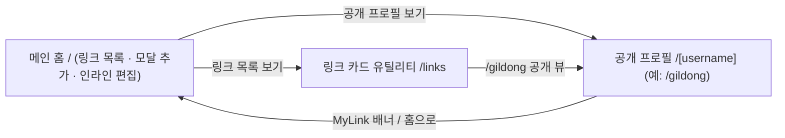

# 마이링크 (MyLink) — 기능정의서 (PRD)

> 링크트리(Linktree) 클론 서비스 — 멀티 링크 & 바이오 프로필 서비스
> 문서 버전: v4.1 · 작성일: 2026-11-15 · 상태: 확정(Confirmed)
> v4.1 변경: **Firestore 인라인 수정(`updateDoc` + `updatedAt: serverTimestamp()`) & 삭제 확인 모달(`DeleteLinkDialog` + `deleteDoc`) 동시 연동** 반영 — 링크 카드 우측 `수정`(연필)·`삭제`(휴지통) 버튼을 호버 여부에 관계없이 항상 표시하고, 인라인 수정 저장 시 `updateDoc` + `updatedAt: serverTimestamp()` 갱신(저장 버튼 내부 스피너·비활성화, 취소 시 원래 값 복구) 및 삭제 버튼 클릭 시 `'정말 삭제하시겠습니까?'` 확인 모달(링크명, 빨간색 `'이 작업은 되돌릴 수 없습니다'` 경고, `shadcn/ui` destructive 빨간색 `삭제하기` 버튼 내부 스피너·비활성화, `deleteDoc` 후 목록 제거)을 `F-03`, `F-04`, `5.1`, `6.3`, `7.2`, `8`, `9`, `10`에 반영
> v4.0 변경: **Firebase SDK 연동 및 Firestore 영속화(Create · Read)** 명세 반영 — API 키 등 Firebase 설정은 `.env.local`(`NEXT_PUBLIC_FIREBASE_*`)로 분리 관리하고, 루트(`/`)의 `내 링크 목록` 추가(`addDoc`)·조회(`getDocs`, `onSnapshot` 미사용)를 **`users/anonymous/links`** 컬렉션(`createdAt` 내림차순 정렬)으로 마이그레이션. 빈 컬렉션 시 더미 데이터 없이 `'등록된 링크가 없습니다'` 빈 상태를 표시하며, 목록 중앙 그레이 스피너 및 저장 버튼 내부 스피너·비활성화(애플 미니멀 모노톤 테마) 규칙을 `F-01`, `F-02`, `5.1`, `6.3`, `7.2`, `9`, `10`에 추가
> v3.10 변경: **가로 400px 이하(모바일 미니)** 좁은 화면에서 `LinkCard` 텍스트가 말줄임표(`...`)로 잘리는 현상을 방지하기 위해, **400px 이하에서는 텍스트·배지·화살표를 숨기고 대표 아이콘(`LinkGlyph`)만 중앙에 표시**하는 반응형 규칙을 `F-01`, `6.3`, `7.2`, `9`에 추가
> v3.9 변경: 프라이머리 CTA 버튼(`+ 링크 추가`, 다이얼로그/인라인 `저장`) 색상을 **애플 모노톤 다크 그레이(`#1d1d1f` / `--primary`)** 로 전환하고 깔끔한 둥근 모서리(`rounded-full`)·은은한 그림자 스타일을 반영. `F-02` 링크 추가 다이얼로그(`AddLinkDialog`)에 **`Zod` + `React Hook Form`(`@hookform/resolvers/zod`)** 검증 규칙(`'제목을 입력해 주세요'`, `'올바른 URL 형식이 아닙니다'`, 통과 시 입력 칸 자동 초기화) 명세 추가
> v3.8 변경: 별도의 `/admin` 관리자 페이지·대시보드 및 임시 데모 계정(`@gildong`) 자동 세션·가짜 로그인(`/login`, `/onboarding`) 우회 스펙을 완전히 제거하고, **강의 표준 7주차 요구사항**에 맞춰 재정렬. 링크 목록 관리(모달 다이얼로그 `AddLinkDialog` 추가·인라인 편집·삭제)는 **메인 페이지(루트 `/`)** 에서 직접 수행하며, 현재 7주차 단계에서는 서버 연동 없이 **브라우저 로컬 메모리 상태(`React useState`)** 로 링크를 관리함을 명시
> v3.7 변경: `F-02` 링크 추가 폼을 **다이얼로그(`shadcn/ui Dialog`)** 방식으로 확정하고 Action Blue(`#0066cc`) CTA 기준 정렬
> v3.6 변경: 전체 스타일링을 CSS Modules(`.module.css`) 없이 **Tailwind CSS 4**(`app/globals.css`) 단일 체계로 통일하고, **shadcn/ui (`Card`, `Badge`, `Button`, `Separator`) 기반 공용 `LinkCard` (`app/components/LinkCard.tsx`)** 재사용 아키텍처 반영
> v3.5 변경: 링크 목록 페이지(`/links`) 및 기본 더미 데이터(`app/links/links-data.ts`의 `dummyLinks` 6종 · `linkListProfile`) 사용 명세를 라우팅, 데이터 모델, 폴더 설계에 반영
> v3.4 변경: UI 컴포넌트 구현 기반을 **shadcn/ui (`https://ui.shadcn.com/create`)** + **Tailwind CSS 4 (CSS-first, `tailwind.config` 파일 미사용)** 로 정의하고, [`design.md`](../design.md)를 Apple 디자인 시스템 기준서로 유지·연동하는 원칙 명시

---

## 1. 프로젝트 개요

| 항목 | 내용 |
|---|---|
| **이름** | 마이링크 (MyLink) |
| **목적** | 개인 크리에이터 및 일반 사용자가 여러 개의 링크(SNS, 블로그, 포트폴리오, 쇼핑몰 등)와 프로필을 한 페이지에 모아 공유하는 **멀티 링크 & 바이오 프로필 서비스** |
| **대상** | 개인 크리에이터, SNS 사용자, 일반 사용자, 인플루언서, 프리랜서, 소상공인 |
| **핵심** | **메인 페이지(루트 `/`)** 상단 프라이머리 `링크 추가` 버튼 기반 **모달(다이얼로그) 링크 추가 + 카드 인라인 편집·삭제**, 공용 링크 목록 뷰(`/links`), 개인 공개 프로필(`/[username]`, `/gildong`) |
| **해결하는 문제** | 인스타그램·틱톡 등 SNS 프로필에 링크를 1개만 넣을 수 있는 제약 해소 |
| **구현 형태 (Firestore 연동)** | **Firebase Firestore(`users/anonymous/links`) 영속 저장소와 연동하는 풀스택 프론트엔드 애플리케이션** — 루트(`/`)가 실제 Firestore 데이터를 조회(`getDocs`, `createdAt` 최신순)·추가(`addDoc`)·인라인 수정(`updateDoc`, `updatedAt: serverTimestamp()`)·확인 모달 삭제(`deleteDoc`)하는 단일 진입점 역할을 수행하며, 컬렉션이 비어 있을 때는 더미 데이터 없이 빈 상태를 표시함 (별도 `/links` 정적 데모 페이지는 기존 상태 유지) |
| **기술 스택** | Next.js 16 (App Router) · React 19 · TypeScript · **Firebase SDK (Firestore)** · `.env.local` 환경 변수 (`NEXT_PUBLIC_FIREBASE_*`) · **Tailwind CSS 4** (CSS-first, `app/globals.css` 단일 스타일시트 — CSS Modules `.module.css` 미사용) · **shadcn/ui** ([`https://ui.shadcn.com/create`](https://ui.shadcn.com/create), `@base-ui/react`, `lucide-react`) · **React Hook Form + Zod** (`@hookform/resolvers/zod`) · Zustand 5 (`/[username]` 공개 프로필 조회용) |
| **디자인 기준** | **컴포넌트 기반**: [`shadcn/ui`](https://ui.shadcn.com/create) 기반으로 UI 프리미티브와 재사용 링크 컴포넌트(`app/components/LinkCard.tsx`)·모달(`app/components/AddLinkDialog.tsx`) 구축<br>**시각 시스템**: [`design.md`](../design.md) 기반 **Apple 디자인 시스템** 스타일 구축 (모노톤 다크 그레이 `#1d1d1f` 프라이머리 CTA 버튼 · 둥근 모서리 & 은은한 그림자, 다크 타일 위 `#2997ff`, 18px 카드, 상단 라이트/하단 다크 풀블리드 타일 교차, SF Pro + Inter/Noto Sans KR 위계) |

### 1.1 성공 지표 (KPI)

| 지표 | 목표 |
|---|---|
| 홈(`/`) 진입 후 모달을 통해 첫 링크를 로컬 목록에 추가하는 시간 | 30초 이내 |
| 루트(`/`) 및 공개 페이지 초기 화면 렌더링 (LCP) | 2.5초 이내 |
| 링크 추가·인라인 편집 성공률 (유효성 안내 포함 오류 없이 반영) | 95% 이상 |

---

## 2. 기능 목록

**우선순위 기준**
- **필수 (P0)**: 현재 7주차 표준 요구사항에 포함되는 핵심 기능
- **선택 (P1)**: 사용성을 높이는 부가 기능
- **확장 (P2)**: 향후 실제 백엔드·인증·DB 연동 주차에서 확장할 기능

| ID | 구분 | 기능명 | 설명 | 우선순위 |
|---|---|---|---|---|
| F-01 | 링크 | 링크 목록 표시 | 루트(`/`)에서는 Firestore(`users/anonymous/links`, `getDocs`, `createdAt` 최신순) 데이터를 불러와 `LinkCard`로 표시하고, `/links`·`/[username]`에서는 정적·시드 목록을 표시 | **필수 (P0)** |
| F-02 | 링크 | 모달 링크 추가 | 루트(`/`) 상단 모노톤 다크 그레이(`#1d1d1f`) `링크 추가` 버튼 → **`shadcn/ui Dialog` 모달**에서 **Zod + React Hook Form** 검증을 거쳐 Firestore `users/anonymous/links`에 저장(`addDoc`)하고 저장 중 버튼 스피너·비활성화 후 목록 자동 갱신 및 입력 칸 초기화 | **필수 (P0)** |
| F-03 | 링크 | 인라인 링크 수정 | 루트(`/`) 링크 목록 카드 우측에 항상 표시되는 `수정`(연필 아이콘) 버튼을 눌러 해당 행을 제목·주소 입력 칸으로 전환(기존 값 자동 채움)하고, `저장` 시 버튼 스피너·비활성화와 함께 Firestore `updateDoc` 및 `updatedAt: serverTimestamp()` 갱신 (`취소` 시 원래 값 복구) | **필수 (P0)** |
| F-04 | 링크 | 확인 모달 링크 삭제 | 루트(`/`) 링크 목록 카드 우측에 항상 표시되는 `삭제`(휴지통 아이콘) 버튼 클릭 시 확인 모달(`DeleteLinkDialog`: `'정말 삭제하시겠습니까?'`, 대상 링크명, 빨간색 `'이 작업은 되돌릴 수 없습니다'`, `취소`/`삭제하기` destructive 버튼)을 띄우고, `삭제하기` 클릭 시 버튼 스피너·비활성화와 함께 Firestore `deleteDoc`으로 문서 삭제 및 목록 제거 | **필수 (P0)** |
| F-05 | 공유 | 개인 URL (`/[username]`) | 사용자별 고유 공개 프로필 뷰 (`/gildong` 예시 포함, 대문자/이전 주소 리다이렉트 및 404 처리) | **필수 (P0)** |
| F-06 | 프로필 | 프로필 및 공부/작품 소개 | 루트(`/`) 상단 프로필(아바타·이름·소개)·공부 기록·연습 작품 쇼케이스 표시 | **필수 (P0)** |
| F-07 | UI | URL 안전성 및 도메인 아이콘 추천 | `http://`, `https://`, `mailto:`만 허용하고 도메인별 13종 아이콘을 자동 추천 | **필수 (P0)** |
| F-08 | 링크 | 링크 순서 변경 | 목록 내 링크 순서 드래그 앤 드롭 또는 `▲`/`▼` 이동 버튼 지원 | 선택 (P1) |
| F-09 | UI | 테마 프리셋 및 버튼 스타일 | 카드형(`18px`) / 필형(`9999px`) 및 라이트/다크 테마 전환 | 선택 (P1) |
| F-10 | 공유 | URL 복사 / QR 코드 | 공개 프로필 주소 원클릭 복사 (`페이지 공유` 버튼 구현됨) | 선택 (P1) |
| F-11 | 확장 | 정식 사용자 인증 및 `/links` 통합 | 정식 사용자 인증(Firebase Auth) 연동 및 `/links` 통합 | 확장 (P2) |

---

## 3. 화면 구성 및 라우팅

> 화면별 상세 텍스트 와이어프레임: [WIREFRAME.md](./WIREFRAME.md)

| 경로 | 화면 | 접근 권한 | 설명 |
|---|---|---|---|
| `/` | 메인 페이지 (프로필 & 링크 관리 홈) *(구현됨)* | 누구나 | 프로필 소개 히어로 + **상단 모노톤 다크 그레이(`#1d1d1f`, 둥근 모서리 & 은은한 그림자) `링크 추가` 프라이머리 버튼** + **`내 링크 목록` (Firestore `users/anonymous/links` `getDocs` 조회 · `addDoc` 추가 · `updateDoc` 인라인 수정 · `deleteDoc` 확인 모달 삭제 · 로딩 스피너)** + 공부 기록/연습 작품 타일 + 연락처 푸터 |
| `/links` | 링크 목록 전용 유틸리티 페이지 *(구현됨)* | 누구나 | Apple 유틸리티 카드(`18px`, 모노톤 다크 그레이 `#1d1d1f` CTA) 기반 정적 데모 페이지. 공용 `LinkCard`(`shadcn/ui Card`) 재사용, [`app/links/links-data.ts`](../app/links/links-data.ts)의 `dummyLinks` 6종 및 `linkListProfile` 유지 |
| `/[username]` | 공개 프로필 페이지 *(구현됨)* | 누구나 | 프로필(아바타·이름·소개) + 소셜 미디어 아이콘 배치 + 섹션 구분 헤더 + 공용 `LinkCard` 링크 목록 (`PublicProfileView` 기반). `/gildong` 기본 시드, 대문자/이전 username 리다이렉트 및 404 처리 포함 (세션 자동 주입 없음) |



---

## 4. 상세 기능 정의

### F-01. 링크 목록 표시 — 필수 (P0)

| 항목 | 내용 |
|---|---|
| **설명** | 사용자가 등록한 기본 URL 링크를 공용 `LinkCard`(`shadcn/ui Card`) 목록으로 표시 |
| **동작 방식** | • **루트(`/`)**: 페이지 로드 시 Firestore **`users/anonymous/links`** 컬렉션에서 실시간 리스너(`onSnapshot`) 대신 **`getDocs` + `orderBy("createdAt", "desc")`** 방식으로 최신순 목록을 불러오며, 불러오는 동안 목록 영역 중앙에 애플 미니멀 모노톤 그레이 스피너를 표시<br>• **`/links`**: `app/links/links-data.ts`의 `dummyLinks` 정적 데모 카드 유지<br>• **`/[username]`**: `PublicProfileView`를 통해 공개 프로필 섹션·링크 카드 표시<br>• **모바일 미니 반응형(`≤ 400px`)**: 가로 폭이 400px 이하로 줄어들면 말줄임표(`...`) 발생을 막기 위해 제목·카테고리 배지·URL 텍스트·우측 화살표를 시각적으로 숨기고(`min-[401px]:block`) **대표 아이콘(`LinkGlyph`)만 카드 중앙에 표시** (`aria-label`·`title` 접근성 유지) |
| **예외 처리** | • 루트(`/`) Firestore 컬렉션 항목이 0개일 때: 더미 데이터 없이 `"등록된 링크가 없습니다"` 빈 상태 안내 문구 표시<br>• 조회 실패 시: 오류 안내 배너와 `'다시 시도'` 버튼 표시 |

### F-02. 모달 링크 추가 (`AddLinkDialog`) — 필수 (P0)

| 항목 | 내용 |
|---|---|
| **설명** | 루트(`/`) 상단의 애플 모노톤 다크 그레이(`#1d1d1f`) 프라이머리 `링크 추가` 버튼을 통해 **모달 다이얼로그(`shadcn/ui Dialog`)** 를 열고, **Zod + React Hook Form** 검증을 거쳐 **Firestore `users/anonymous/links` 컬렉션에 문서를 저장(`addDoc`)** |
| **동작 방식** | 루트(`/`) 상단 `링크 추가` 버튼 클릭 → **`shadcn/ui Dialog` 기반 `AddLinkDialog` 열림** → `zodResolver(addLinkFormSchema)` + `useForm`으로 입력 검증 → URL 입력/블러 시 프로토콜(`https://`) 자동 보정 및 도메인 맞춤 아이콘 자동 추천 → `저장` 클릭 → **저장 버튼 내부 스피너 회전 및 버튼 비활성화(중복 클릭 방지)** → Firestore `users/anonymous/links`에 `{ title, url, icon, category, createdAt: serverTimestamp() }` 저장(`addDoc`) → **저장 성공 시 `getDocs`로 목록 자동 갱신(최신순 반영) · 폼 입력 칸 초기화(`reset()`)** → 다이얼로그 닫힘 + `"링크가 추가되었습니다 (제목)"` 토스트 |
| **취소 / 실패** | • 저장 중이 아닐 때 `취소` 버튼, 닫기(`X`), 배경 클릭 또는 `Esc` 키 → `reset()`으로 입력값·오류 상태 초기화 후 다이얼로그 닫힘<br>• Firestore 저장 실패 시: 모달을 닫지 않고 모달 내 에러 알림(`role="alert"`) 표시 |

**입력 항목**

| 필드 | 타입 | 필수 | 규칙 | 예시 |
|---|---|---|---|---|
| 제목 | 텍스트 | ✅ | 1~50자, 앞뒤 공백 제거 | `내 유튜브 채널` |
| URL | 텍스트 | ✅ | `http://`, `https://`, `mailto:` 스킴만 허용, 최대 2,048자 | `https://youtube.com/@mystudio`, `mailto:hello@example.com` |
| 아이콘 | 선택 목록 | ❌ | 13종 중 선택 (기본값: `link`). URL 입력 시 도메인·스킴 기반 자동 선택(수동 변경 가능) | `link`, `instagram`, `youtube`, `tiktok`, `x`, `threads`, `github`, `kakao`, `naver`, `blog`, `email`, `shop`, `portfolio` |

**아이콘 자동 추천 규칙**
- `instagram.com` → `instagram` / `youtube.com`, `youtu.be` → `youtube` / `tiktok.com` → `tiktok`
- `x.com`, `twitter.com` → `x` / `threads.net` → `threads` / `github.com` → `github`
- `kakao.com`, `open.kakao.com`, `pf.kakao.com` → `kakao` / `naver.com`, `blog.naver.com`, `smartstore.naver.com` → `naver`
- `velog.io`, `medium.com`, `tistory.com` → `blog` / `mailto:` → `email` / 기타 URL은 기본 `link`

**예외 처리**

| 상황 | 처리 |
|---|---|
| URL 형식 오류 / 빈 URL / 위험 스킴 | 입력창 테두리 **빨간색(`#e30000`)** + 아래 빨간 글씨 **`"올바른 URL 형식이 아닙니다"`** 및 제출 중단 |
| 프로토콜 누락 (`youtube.com/@mystudio`) | 포커스 아웃(blur) 또는 저장 시 자동으로 `https://`를 앞에 붙여 보정 후 검사 |
| `mailto:` 형식 오류 (`mailto:abc`) | 올바른 이메일 형식이 아니면 빨간색 경고 **`"올바른 URL 형식이 아닙니다"`** 및 제출 중단 |
| 제목 미입력 / 공백 | 입력창 빨간색 + **`"제목을 입력해 주세요"`** 및 제출 중단 |
| 제목 50자 초과 | 입력 제한 + 글자 수 카운터(`50/50`) 빨간색 |
| 최대 등록 수(50개) 초과 | 추가 버튼 비활성화 + `"항목은 최대 50개까지 등록할 수 있습니다"` |

### F-03. 인라인 링크 수정 (`updateDoc`) — 필수 (P0)

| 항목 | 내용 |
|---|---|
| **설명** | 별도 페이지 이동 없이 루트(`/`) 링크 카드 우측에 **항상 표시되는 `수정`(연필 아이콘) 버튼**을 눌러 해당 행을 인라인 편집 폼으로 전환해 수정하고 Firestore에 반영 |
| **동작 방식** | 카드 우측 `수정`(연필 아이콘) 클릭 → 그 자리에서 기존 제목·주소 값이 채워진 `제목`·`주소 (URL)` 입력 칸으로 전환 → 수정 후 `저장` 클릭 → 유효성 검사 및 URL 변경 시 도메인 기반 아이콘·카테고리 갱신 → **`저장` 버튼 내부 회전 스피너 표시 및 비활성화** → Firestore `users/anonymous/links/{docId}`에 **`updateDoc(..., { title, url, icon, category, updatedAt: serverTimestamp() })`** 호출 → 성공 시 목록 갱신, 편집 종료 및 `"링크가 수정되었습니다 (제목)"` 토스트 |
| **취소 / 예외** | `취소` 버튼 클릭(또는 `Esc` 키) 시 입력 중이던 변경을 버리고 원래 값의 링크 카드로 복구 · 제목/URL 유효성 오류 또는 Firestore 오류 시 인라인 빨간 오류 메시지(`#e30000`) 표시 및 폼 유지 |

### F-04. 확인 모달 기반 링크 삭제 (`DeleteLinkDialog` · `deleteDoc`) — 필수 (P0)

| 항목 | 내용 |
|---|---|
| **설명** | 루트(`/`) 링크 카드 우측에 **항상 표시되는 `삭제`(휴지통 아이콘) 버튼** 클릭 시 삭제 확인 모달을 띄우고, 최종 확인 시 Firestore에서 문서를 삭제 |
| **동작 방식** | `삭제`(휴지통 아이콘) 버튼 클릭 → `DeleteLinkDialog` 모달 열림(**`'정말 삭제하시겠습니까?'` 제목**, **삭제할 링크 이름**, **빨간색(`#e30000`) `'이 작업은 되돌릴 수 없습니다'` 경고 문구**, `취소` 버튼 및 **`shadcn/ui` `destructive` 빨간색 `삭제하기` 버튼** 포함) → `삭제하기` 클릭 → **`삭제하기` 버튼 내부 회전 스피너 표시 및 비활성화(모달 닫기 차단)** → Firestore `users/anonymous/links/{docId}`에 **`deleteDoc`** 호출 → 성공 시 목록에서 제거, 모달 닫힘 및 `"링크가 삭제되었습니다 (제목)"` 토스트 표시 |
| **취소 / 예외** | 삭제 중이 아닐 때 `취소`, 닫기(`X`), `Esc`, 배경 클릭으로 삭제 취소 · Firestore `deleteDoc` 실패 시 모달을 닫지 않고 모달 내 빨간 오류 안내(`role="alert"`) 표시 |

### F-05. 개인 URL (`/[username]`) — 필수 (P0)

| 항목 | 내용 |
|---|---|
| **설명** | 사용자별 고유 공개 프로필 페이지(`/gildong` 등) 조회 및 대문자/과거 주소 자동 리다이렉트 |
| **동작 방식** | 방문자가 `/{username}` 접속 → 활성 `username` 조회 → 없으면 이전 `username` 이력 조회 후 리다이렉트 → 둘 다 없으면 404 안내 화면 |
| **예약어** | `admin`, `login`, `onboarding`, `links`, `api`, `auth`, `settings`, `about`, `demo`, `404`, `robots.txt`, `sitemap.xml` |

---

## 5. 상태 관리 및 데이터 구조 (Firebase Firestore 기준)

### 5.1 루트(`/`) 링크 영속화 — Firebase Firestore (`users/anonymous/links`)

- **컬렉션 경로**: `users/anonymous/links` (`collection(db, "users", "anonymous", "links")`)
- **조회 정책**: 페이지 초기 마운트 및 링크 추가 직후 **`getDocs` + `orderBy("createdAt", "desc")`** 로 일회성 조회를 수행해 최신순 목록을 반영하며, 실시간 리스너(`onSnapshot`)는 불필요한 리소스 낭비를 막기 위해 사용하지 않습니다.
- **빈 상태 정책**: 컬렉션에 저장된 문서가 0건일 때 `dummyLinks`를 채우지 않고 빈 목록(`[]`)으로 두어 `"등록된 링크가 없습니다"` 안내를 표시합니다.
- **문서 스키마 (`users/anonymous/links/{docId}`)**:

| 필드명 | 타입 | 필수 | 설명 | 예시 |
|---|---|---|---|---|
| `title` | `string` | ✅ | 공백 제거된 링크 제목 (1~50자) | `"내 유튜브 채널"` |
| `url` | `string` | ✅ | 검증 및 프로토콜 보정 완료된 안전 URL | `"https://youtube.com/@mystudio"` |
| `icon` | `LinkIcon` | ✅ | 13종 아이콘 키 | `"youtube"` |
| `category` | `string` | ✅ | 아이콘에 매핑된 한글 카테고리명 | `"YouTube"` |
| `createdAt` | `Timestamp` (`serverTimestamp()`) | ✅ | Firestore 서버 생성 시각 (최신순 정렬 기준) | `Timestamp` |
| `updatedAt` | `Timestamp` (`serverTimestamp()`) | ❌ | 인라인 수정(`updateDoc`) 시 갱신되는 Firestore 서버 수정 시각 | `Timestamp` |

- **환경 변수 분리 (`.env.local`)**: `NEXT_PUBLIC_FIREBASE_API_KEY`, `NEXT_PUBLIC_FIREBASE_AUTH_DOMAIN`, `NEXT_PUBLIC_FIREBASE_PROJECT_ID`, `NEXT_PUBLIC_FIREBASE_STORAGE_BUCKET`, `NEXT_PUBLIC_FIREBASE_MESSAGING_SENDER_ID`, `NEXT_PUBLIC_FIREBASE_APP_ID`를 `.env.local`에 분리 보관하고 `.gitignore`로 Git 커밋 대상에서 제외합니다.

### 5.2 공개 프로필 예시 뷰 (`/[username]`) 보조 타입 (`app/lib/types.ts` · `useMyLinkStore.ts`)

- 공개 프로필 쇼케이스(`/[username]`, `/gildong`)는 `PublicProfileView`의 테마 프리셋(`apple-classic`, `pure-light`, `midnight-dark`, `soft-blue`), 버튼 스타일(`card`, `pill`), 리다이렉트 이력(`usernameHistory`) 및 읽기 전용 방문·클릭 카운터를 유지합니다.
- 사용자 인증 세션(`currentUserId`)이나 자동 로그인 우회 로직은 포함하지 않습니다.

---

## 6. 비기능 요구사항

### 6.1 성능

| 항목 | 기준 |
|---|---|
| 초기 렌더링 속도 | 루트(`/`) 및 공개 페이지 LCP 2.5초 이내 (4G 모바일 기준) |
| UI 반응 속도 | Firestore 비동기 조회·추가 중에는 애플 미니멀 모노톤 스피너로 진행 상태를 즉시 피드백하고 중복 제출 방지 |
| 이미지 최적화 | 정적 이미지는 `next/image`로 최적화 |

### 6.2 보안 및 데이터 안정성

| 항목 | 기준 |
|---|---|
| XSS 방지 | 사용자 입력(링크 제목, URL 등)은 React 기본 이스케이프로 출력하고 `dangerouslySetInnerHTML` 사용 금지 |
| URL 안전성 | `http://`, `https://`, `mailto:` 스킴만 허용하고 `javascript:`, `data:`, `vbscript:` 등 악성 스크립트 URL 차단 (`resolveSafeHref`) |
| 외부 링크 보호 | `http`/`https` 외부 링크에 `target="_blank" rel="noopener noreferrer"` 적용 |
| 환경 변수 보안 | Firebase API 키·프로젝트 설정을 `.env.local`의 `NEXT_PUBLIC_FIREBASE_*`로 분리하고 `.gitignore`(`.env*`)를 통해 소스 코드/Git 저장소 노출 방지 |

### 6.3 사용성 · 접근성

| 항목 | 기준 |
|---|---|
| 반응형 | 모바일 우선 설계 (320px ~ 1440px), 링크 관리 목록 최대 폭 680px. **가로 400px 이하(`≤ 400px`)에서는 `LinkCard` 말줄임표(`...`)를 방지하기 위해 텍스트 없이 대표 아이콘만 중앙 표시** |
| 터치 영역 | 버튼·링크 카드 최소 높이 44px 이상 (`min-h-11`) |
| 접근성 | WCAG 2.1 AA 명도 대비 4.5:1 이상, 포커스 링(`#0071e3`), 아이콘 버튼 `aria-label` 필수, 스피너 `role="status"` / `aria-busy` 적용 |
| 오류 표시 | 빨간색(`#e30000`) + 텍스트 메시지를 함께 사용, `aria-invalid` · `aria-describedby` 적용 |
| 로딩 표시 | • 목록 조회/갱신 시: 카드 내부 중앙 그레이 미니멀 스피너<br>• 링크 추가/인라인 수정 시: `저장` 버튼 내부 스피너 회전 및 버튼 비활성화(중복 클릭 방지)<br>• 확인 모달 삭제 시: `삭제하기` 버튼 내부 스피너 회전 및 버튼 비활성화 |
| 피드백 | 링크 추가·인라인 수정·삭제 결과를 `role="status"` 플로팅 토스트로 안내 |

---

## 7. 디자인 시스템 및 UI 구현 전략

UI 컴포넌트 개발은 **[shadcn/ui (`https://ui.shadcn.com/create`)](https://ui.shadcn.com/create)** 를 기반으로 진행하며, 브랜드·시각적 완성도는 **[`design.md`](../design.md)** 에 정의된 **Apple 디자인 시스템** 기준으로 구축합니다.

### 7.1 역할 분리: shadcn/ui (컴포넌트 기반) + Apple 시스템 (`design.md`)

| 구분 | 기준 | 적용 범위 및 원칙 |
|---|---|---|
| **UI 컴포넌트 아키텍처** | **shadcn/ui** ([`https://ui.shadcn.com/create`](https://ui.shadcn.com/create)) | • 모든 UI 프리미티브(`Alert`, `Badge`, `Button`, `Card`, `Dialog`, `Input`, `Label`, `Select`, `Separator`, `Spinner`, `Switch`, `Tabs`, `Textarea`, `Tooltip`)는 `components/ui/*`(`base-nova` 프리셋 · `@base-ui/react` · `lucide-react`) 기반으로 구축·확장한다.<br>• 링크 카드 UI는 `shadcn/ui Card` + `Badge` 기반 공용 컴포넌트 **`app/components/LinkCard.tsx`** 로 단일화하여 루트(`/`), `/links`, `/[username]`(`PublicProfileView`)에서 재사용한다.<br>• 스타일링은 CSS Modules(`.module.css`) 없이 **Tailwind CSS 4**(`app/globals.css`) 단일 체계로 통일한다. |
| **시각 디자인 시스템** | **[`design.md`](../design.md)** (Apple 디자인 시스템) | • 프라이머리 버튼(`--primary` / `bg-primary`)은 **애플 모노톤 다크 그레이(`#1d1d1f`)** + 순백 텍스트(`#ffffff`) + **깔끔한 둥근 모서리(`rounded-full`) · 은은한 그림자(`shadow-[0_2px_10px_rgba(0,0,0,0.12)]`)** 를 적용하고, 포커스 링 `#0071e3` · 다크 타일 위 보조 블루(`#2997ff`, `--color-action-blue: #0066cc`) · 카드 `18px` 둥근 모서리를 유지한다.<br>• 루트(`/`) 상단 **`링크 추가`** 버튼은 히어로 CTA 행 최전방에 배치해 시각적 최우선 위계를 부여한다. |

### 7.2 화면별 시각 가이드

| 화면 / 요소 | 적용 스타일 |
|---|---|
| **메인 페이지(`/`)** | 상단 라이트 히어로(아바타 · 이름 · **`링크 추가` 모노톤 다크 그레이 `#1d1d1f` 필 CTA + 은은한 그림자** · 보조 `GitHub` · `이메일 복사` · **`내 링크 목록`** Firestore 연동 카드, 항상 노출되는 `수정`/`삭제` 아이콘 버튼 & 중앙 그레이 로딩 스피너) ↔ 하단 다크 타일 교차 레이아웃 (`design.md` 기준) |
| **`AddLinkDialog` 모달** | White(`#ffffff`) 배경 `18px` 둥근 모서리, `shadcn/ui Input`/`Select`, `Zod + React Hook Form` 검증(오류 시 `#e30000` 경고), 하단 모노톤 다크 그레이(`#1d1d1f`) 필형 `저장` 버튼(저장 중 내부 스피너 + 비활성화) |
| **`DeleteLinkDialog` 모달** | White(`#ffffff`) 배경 `18px` 둥근 모서리, `'정말 삭제하시겠습니까?'` 제목, 삭제 대상 링크 이름/URL 요약, 빨간색(`#e30000` / `text-destructive`) `'이 작업은 되돌릴 수 없습니다'` 경고, `취소` + `shadcn/ui` **`variant="destructive"`(빨간색 `bg-destructive` + 흰색 텍스트)** `삭제하기` 버튼(삭제 중 내부 스피너 + 비활성화) |
| **로딩 스피너 (`Spinner`)** | 애플 미니멀 모노톤(`#6e6e73` / `#1d1d1f` / 버튼 위 `#ffffff`), 1.5~2px stroke `Loader2` 회전 애니메이션 (`components/ui/spinner.tsx`) |
| **공용 `LinkCard` 모바일 미니(`≤ 400px`)** | `401px` 이상: `[아이콘] + [제목 · 배지 · URL] + [›]` / `400px` 이하: 텍스트·배지·화살표 숨김, **대표 아이콘(`LinkGlyph`)만 중앙 정렬 표시** (`aria-label`·`title` 유지) |
| **오류 색상** | Error Red(`#e30000`) — 유효성 오류 테두리(`--destructive`) 및 안내 문구 |

---

## 8. 범위 외 (Out of Scope, 현재 Firestore CRUD 연동 기준)

- 별도 관리자 대시보드 라우트(`/admin`) 및 임시 데모 계정 자동 세션 주입
- 가짜 로그인 우회 화면(`/login`, `/onboarding`)
- 실시간 구독(`onSnapshot`), 정식 사용자 인증(Firebase Auth) 및 `/links` 정적 데모 페이지의 DB 연동

---

## 9. 수용 기준 (Acceptance Criteria, v4.1 Firestore CRUD 연동 기준)

- [x] Firebase SDK(`firebase`)가 설치되고, 모든 Firebase 설정값이 `.env.local`의 `NEXT_PUBLIC_FIREBASE_*` 환경 변수로 분리되어 Git 추적에서 제외된다.
- [x] 루트(`/`) 진입 시 `getDocs` + `orderBy("createdAt", "desc")` 방식으로 `users/anonymous/links` 컬렉션을 불러오며(`onSnapshot` 미사용), 컬렉션이 비어 있을 때 더미 데이터 없이 `'등록된 링크가 없습니다'` 안내가 표시된다.
- [x] `'링크 추가'` 모달(`AddLinkDialog`)에서 **Zod + React Hook Form** 검증 통과 후 `'저장'` 클릭 시 **저장 버튼 내부 스피너가 회전하며 버튼이 비활성화(중복 클릭 방지)** 된다.
- [x] Firestore `users/anonymous/links`에 문서가 저장(`addDoc`, `createdAt: serverTimestamp()`)되면 `getDocs`로 목록이 자동 갱신(최신순)되고 입력 칸 초기화·모달 닫힘·토스트 알림이 동작한다.
- [x] 링크 카드 우측의 연필(`수정`)·휴지통(`삭제`) 버튼이 호버 시에만 나타나는 것이 아니라 **항상 표시**된다.
- [x] 연필(`수정`) 버튼 클릭 시 해당 행이 기존 제목·주소가 채워진 인라인 편집 폼으로 전환되고, `저장` 시 버튼 내부 스피너·비활성화와 함께 Firestore `updateDoc` 및 `updatedAt: serverTimestamp()`가 갱신되며, `취소` 시 원래 값으로 복구된다.
- [x] 휴지통(`삭제`) 버튼 클릭 시 `'정말 삭제하시겠습니까?'` 제목, 삭제할 링크 이름, 빨간색 `'이 작업은 되돌릴 수 없습니다'` 경고 문구, `취소` 및 `shadcn/ui` `destructive`(빨간색) `삭제하기` 버튼이 포함된 확인 모달(`DeleteLinkDialog`)이 열린다.
- [x] 삭제 확인 모달의 `삭제하기` 클릭 시 버튼 내부 스피너·비활성화와 함께 Firestore `deleteDoc`으로 문서가 삭제되고 목록에서 제거된다.
- [x] 목록 초기 불러오기 및 갱신 중에는 `'내 링크 목록'` 영역 중앙에 애플 미니멀 모노톤 그레이 스피너가 표시된다.
- [x] 제목 미입력 시 `'제목을 입력해 주세요'`, 잘못된 URL 또는 위험 스킴(`javascript:`) 입력 시 `'올바른 URL 형식이 아닙니다'` 빨간 에러 문구(`#e30000`)가 표시되고 제출이 중단된다.
- [x] 가로 400px 이하 모바일 미니 폭에서 `LinkCard`가 `...` 말줄임 없이 **대표 아이콘만 깔끔하게 중앙 표시**되고, 401px 이상에서는 제목·URL이 모두 표시된다.
- [x] `/links` 정적 데모 페이지와 `/gildong` 공개 뷰가 공용 `LinkCard`와 Tailwind CSS 4로 정상 렌더링된다.
- [x] `npx tsc --noEmit`, `npm run lint`, `npm run build`가 오류 없이 통과한다.

---

## 10. 구현 구조 및 검증 체크표

### 10.1 폴더 및 모듈 구조

```text
my_link/
├── .env.local                    # Firebase 환경 변수 (NEXT_PUBLIC_FIREBASE_*, .gitignore 제외 대상)
├── components.json               # shadcn/ui 설정 (base-nova, Tailwind CSS 4 CSS-first 규격)
├── lib/
│   ├── utils.ts                  # shadcn/ui 공용 cn() 클래스 병합 유틸리티
│   └── firebase.ts               # Firebase App 싱글톤 초기화 & Firestore(db) 인스턴스
├── components/
│   └── ui/                       # shadcn/ui 공용 프리미티브 (alert, badge, button, card, dialog, input, label, select, separator, spinner, switch, tabs, textarea, tooltip)
├── app/
│   ├── globals.css               # 유일한 CSS 파일 — Tailwind CSS 4 (@import "tailwindcss", @theme) + design.md Apple 토큰 매핑
│   ├── layout.tsx                # Inter · Noto Sans KR 폰트 & TooltipProvider 설정
│   ├── page.tsx                  # 메인 페이지 (/) — 프로필 히어로 + HomeLinkManager + 공부 기록 + 연습 작품 + 푸터
│   ├── links/                    # 링크 카드 유틸리티 페이지 (/links, 정적 데모 유지)
│   │   ├── page.tsx              # 프로필 요약 카드 + 공용 LinkCard 목록 화면
│   │   ├── links-data.ts         # 기본 더미 데이터 (dummyLinks 6종 · linkListProfile)
│   │   └── components/
│   │       ├── LinkCard.tsx      # app/components/LinkCard 재사용 위임 래퍼
│   │       ├── LinkIconBadge.tsx # LinkGlyph + Tailwind CSS 아이콘 컨테이너
│   │       └── CopyPageUrlButton.tsx # 현재 페이지 주소 복사 Action Blue 필 버튼
│   ├── [username]/               # 공개 프로필 페이지 (/gildong 등)
│   │   ├── page.tsx              # Server Component (generateStaticParams)
│   │   └── PublicProfileClient.tsx # 하이드레이션 가드·리다이렉트·404·읽기 전용 뷰
│   ├── stores/
│   │   └── useMyLinkStore.ts     # /[username] 공개 뷰 상태 (임시 데모 세션/로그인 우회 미포함)
│   ├── lib/
│   │   ├── types.ts              # LinkIcon, LinkItem, ThemePreset 등 도메인 타입
│   │   ├── firestore-links.ts    # users/anonymous/links Firestore CRUD(addDoc · getDocs · updateDoc · deleteDoc) 서비스
│   │   ├── mock-seed.ts          # /gildong 공개 뷰 시드 데이터
│   │   ├── validators.ts         # URL(http/https/mailto)·제목(1~50자)·예약어 검증 및 https 보정
│   │   ├── icon-matcher.ts       # 도메인·스킴 기반 13종 아이콘 자동 추천
│   │   └── themes.ts             # 프리셋 테마 토큰 (Apple 클래식 기본) & 버튼 스타일
│   └── components/
│       ├── TopNav.tsx            # 상단 바 & 스티키 서브헤더 (/admin 링크 미포함)
│       ├── HomeLinkManager.tsx   # 루트(/) Firestore(users/anonymous/links) 조회·추가·인라인 수정·삭제 모달 관리
│       ├── AddLinkDialog.tsx     # shadcn/ui Dialog + Select 기반 링크 추가 모달 (저장 중 스피너·비활성화)
│       ├── DeleteLinkDialog.tsx  # shadcn/ui Dialog + destructive 버튼 기반 삭제 확인 모달 (삭제 중 스피너·비활성화)
│       ├── LinkCard.tsx          # shadcn/ui Card + Badge + Tailwind CSS 공용 링크 카드
│       ├── LinkGlyph.tsx         # 13종 링크 아이콘 + 소셜 플랫폼 Lucide 통합 매핑
│       ├── PublicProfileView.tsx # 공개 프로필 공용 뷰 (/[username])
│       └── PublicProfileSkeleton.tsx # SSR/CSR 하이드레이션 안전 스켈레톤
```

### 10.2 단계별 구현 마일스톤

| 단계 | 핵심 구현 목표 | 완료 기준 (Definition of Done) |
|---|---|---|
| **M1** *(완료)*<br>스타일 & 공용 컴포넌트 | • Tailwind CSS 4 단일 스타일링 및 `shadcn/ui Card` 기반 공용 `LinkCard` 구축<br>• `/links` 유틸리티 뷰 및 `/gildong` 공개 프로필 뷰 구현 | • CSS Modules 없이 Tailwind 4 단일 체계 동작<br>• `/links`, `/gildong`, `/`에서 동일한 `LinkCard` 재사용 |
| **M2** *(완료)*<br>홈(`/`) 모달 추가 · 검증 · 미니 반응형 | • `/admin` 제거 후 루트(`/`) 상단 모노톤 다크 그레이(`#1d1d1f`) `링크 추가` 버튼 + `AddLinkDialog` 모달 구현<br>• `Zod + React Hook Form` 검증 및 `≤ 400px` 모바일 미니 아이콘 전용 `LinkCard` 적용 | • 루트(`/`) 모달 검증 및 유효성 오류 `#e30000` 경고 출력<br>• `≤ 400px`에서 말줄임 없이 아이콘만 중앙 표시 |
| **M3** *(완료 · v4.0)*<br>Firebase SDK & Firestore Create/Read & 로딩 스피너 | • `firebase` SDK 설치 및 `.env.local` 분리 (`lib/firebase.ts`)<br>• 루트(`/`) `users/anonymous/links` `addDoc` 저장 + `getDocs`(`createdAt` 내림차순) 조회·자동 갱신<br>• 목록 중앙 그레이 스피너 & 모달 저장 버튼 스피너·비활성화 | • `.env.local` 미추적 상태에서 빌드·런타임 동작<br>• 빈 컬렉션 시 `'등록된 링크가 없습니다'` 표시, 새 링크 저장 후 새로고침 시에도 최신순 유지 |
| **M4** *(완료 · v4.1)*<br>Firestore Update/Delete 동시 연동 | • 링크 카드 우측 항상 노출 `수정`(연필)·`삭제`(휴지통) 버튼<br>• 인라인 수정 `updateDoc` + `updatedAt: serverTimestamp()` + 취소 시 원복<br>• `DeleteLinkDialog` 확인 모달 + `destructive` 삭제하기 + `deleteDoc` + 버튼 스피너·비활성화 | • 새로고침 후에도 수정/삭제 결과 영속 유지<br>• 저장/삭제 중 버튼 내부 스피너 회전 및 비활성화 |

### 10.3 핵심 사용자 시나리오 (v4.1 Firestore CRUD 기준)

1. **루트(`/`) 진입 및 Firestore 초기 로드**:
   - 홈 화면 진입 시 `내 링크 목록` 중앙에 미니멀한 그레이 로딩 스피너가 표시된 뒤, `getDocs`(`orderBy("createdAt", "desc")`)로 `users/anonymous/links` 데이터를 불러온다.
   - 데이터가 0건이면 더미 데이터 없이 `'등록된 링크가 없습니다'` 빈 상태 안내가 표시된다.
2. **모달(`AddLinkDialog`) 검증 & Firestore 저장 & 자동 갱신**:
   - `링크 추가` 버튼 클릭 → `새 링크 추가` 다이얼로그가 열린다.
   - 유효성 실패 시 `'제목을 입력해 주세요'` / `'올바른 URL 형식이 아닙니다'` 빨간 문구와 함께 제출이 중단된다.
   - 유효한 입력 후 `저장` 클릭 → **버튼 내부 스피너가 회전하며 버튼이 비활성화**되고, Firestore `users/anonymous/links`에 문서가 추가(`addDoc`)된 뒤 `getDocs`로 목록이 자동 갱신되어 새 링크가 최상단에 표시된다.
3. **인라인 수정 & Firestore `updateDoc` + `updatedAt: serverTimestamp()`**:
   - 항상 표시되는 연필 아이콘(`수정`) 버튼을 클릭하면 해당 카드 자리가 기존 제목과 주소 값이 채워진 입력 칸으로 바뀐다.
   - `취소`를 누르면 원래 값으로 복구되고, `저장`을 누르면 버튼 내부 스피너가 돌며 비활성화된 상태에서 Firestore `updateDoc`(`updatedAt: serverTimestamp()` 포함)이 실행되어 목록에 즉시 반영된다.
4. **확인 모달(`DeleteLinkDialog`) & Firestore `deleteDoc`**:
   - 항상 표시되는 휴지통 아이콘(`삭제`) 버튼을 클릭하면 `'정말 삭제하시겠습니까?'` 제목, 삭제할 링크 이름, 빨간색 `'이 작업은 되돌릴 수 없습니다'` 경고 문구, `취소` 및 `destructive`(빨간색) `삭제하기` 버튼이 포함된 모달이 열린다.
   - `삭제하기`를 누르면 버튼 내부 스피너가 돌며 비활성화된 상태에서 Firestore `deleteDoc`으로 문서가 삭제되고 목록에서 제거된다.
